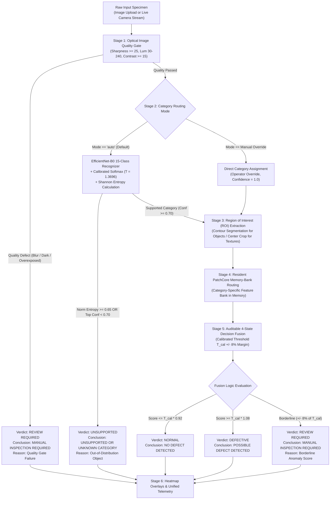

# DefectVision AI — Industrial Visual Anomaly Detection & Automatic Category Inspection Platform

[](https://github.com/suryacharan945/DefectVision-AI/releases/tag/v1.1.0)
[](LICENSE)
[](https://www.python.org/)
[](https://react.dev/)
[](https://pytorch.org/)
[](https://github.com/facebookresearch/faiss)
[](https://fastapi.tiangolo.com/)
[](tests/)

> **Status:** Research Prototype & Open-Source Benchmark.
> **Target Audience:** Computer vision scientists, quality assurance automation engineers, and MLOps researchers.
> **Key Differentiator:** Combines **Automatic 15-Class Visual Category Recognition** (EfficientNet-B0 with temperature calibration and Shannon entropy open-set rejection) with state-of-the-art unsupervised memory-bank anomaly detection (**PatchCore**), optical image quality gating, and an auditable **4-state decision fusion engine** for both file upload and real-time live camera streams.

---

## 1. Project Capabilities

Manufacturing visual inspection requires rapid, reliable anomaly detection across diverse product lines without requiring operators to manually switch software profiles.

DefectVision AI provides an end-to-end, zero-click optical inspection system:
- **Automatic Category Recognition:** Automatically recognizes which of the 15 official MVTec AD categories is presented, routing to the correct memory bank without manual operator selection.
- **Image Upload Inspection:** Drag-and-drop image analysis with automatic class detection, calibrated anomaly scoring, and interactive false-color heatmaps.
- **Real-Time Live Camera Stream:** In-memory optical inspection of browser webcam or industrial camera feeds with HUD targeting reticle and telemetry overlays.
- **Optical Image Quality Gate:** Intercepts out-of-focus, motion-blurred, underexposed, or glare-saturated frames before computational inference.
- **Category-Specific PatchCore Routing:** 15 resident memory banks indexed for fast nearest-neighbor distance scoring.
- **Auditable 4-State Decision Fusion:** Calibrated category thresholds with an explicit $\pm 8\%$ borderline guard band for human triage.
- **Open-Set Out-of-Distribution (OOD) Rejection:** Rejects non-industrial or unsupported items via Shannon entropy ($H_{norm} \ge 0.65$) and calibrated confidence gating.
- **Inspection History & Telemetry:** Thread-safe audit ring buffer with session statistics and one-click inspection modal review.

---

## 2. Six-Stage End-to-End Architecture



For complete technical specifications, see [`docs/REALTIME_AUTOMATIC_INSPECTION.md`](docs/REALTIME_AUTOMATIC_INSPECTION.md).

---

## 3. Four Inspection Outcomes Contract

| Verdict | Operator Conclusion | Badge Tone | Trigger Criteria | Action Required |
| :--- | :--- | :---: | :--- | :--- |
| **`NORMAL`** | `NO DEFECT DETECTED` | Emerald | Quality passed; Category recognized; Score $\le 0.92 \times T_{cal}$. | Component passes automated inspection. |
| **`DEFECTIVE`** | `POSSIBLE DEFECT DETECTED` | Rose | Quality passed; Category recognized; Score $\ge 1.08 \times T_{cal}$. | Reject or divert part to quarantine. |
| **`REVIEW REQUIRED`** | `MANUAL INSPECTION REQUIRED` | Amber | Quality gate failed OR Score within borderline band ($\pm 8\%$). | Secondary manual inspection by human QA specialist. |
| **`UNSUPPORTED`** | `UNSUPPORTED OR UNKNOWN CATEGORY` | Purple | Category recognizer entropy $\ge 0.65$ or confidence $< 70\%$. | Verify part placement or register new product profile. |

### Standardized Limitation Disclaimer
Every diagnosis record generated by the system embeds the standardized disclaimer:
> *"The result reflects the model's learned visual patterns and does not guarantee the absence of all possible defects."*

---

## 4. Verified Benchmark Results

### 1. Category Classifier (EfficientNet-B0)
Evaluated across nominal validation (726 images), official test split (1,725 images across all 15 classes), and open-set OOD rejection cohorts:
- **Validation Accuracy (726 images):** **100.00%** (Macro F1: 100.00%)
- **Official Test Set Accuracy (1,725 images):** **99.94%** (Macro F1: 99.94%)
  - Only 1 specimen misclassified across all 1,725 test images (1,724 / 1,725 correct).
  - 13 out of 15 categories achieved **100.00% Precision and 100.00% Recall**.
- **CPU Inference Latency:** Mean: 86.82 ms | p50: 82.92 ms | p95: 124.05 ms.
- **Open-Set OOD Rejection:** Synthetic noise, solid color, and untextured surfaces correctly rejected as `UNSUPPORTED`.

### 2. PatchCore Anomaly Inspection (1,725 Test Images)
Evaluated on official quarantined test specimens using disjoint category memory banks and calibrated decision thresholds:
- **Macro Image AUROC:** **97.15%**
- **Macro Image AUPRC:** **98.98%**
- **Defect Recall (Sensitivity):** **95.40%** (1,200 defects detected out of 1,258)
- **Specificity:** **70.96%** (351 nominals cleared out of 467)
- **Macro F1-Score:** **92.40%**

> **Scientific Disclosure on Specificity:**
> The 70.96% specificity indicates a meaningful false-positive burden (116 false alarms out of 467 nominal test samples), primarily occurring on stochastic surface textures (`leather`, `tile`, `wood`, `toothbrush`). The system prioritizes high sensitivity (95.40% recall) to minimize defect escapes in industrial quality control, routing ambiguous specimens to `REVIEW REQUIRED` rather than forcing premature rejection.

Full per-category tables and confusion matrices are documented in [`docs/EVALUATION_RESULTS.md`](docs/EVALUATION_RESULTS.md).

---

## 5. Supported MVTec AD Categories

The system supports all 15 official MVTec Anomaly Detection domains:
- **Ten Objects:** `bottle`, `cable`, `capsule`, `hazelnut`, `metal_nut`, `pill`, `screw`, `toothbrush`, `transistor`, `zipper`.
- **Five Textures:** `carpet`, `grid`, `leather`, `tile`, `wood`.

Detailed dataset split structures and model training guides are published in [`docs/MVTEC_DATASET_AND_MODELS.md`](docs/MVTEC_DATASET_AND_MODELS.md).

---

## 6. Installation & Quickstart Guide

### Prerequisites
- **Operating System:** Windows 10 / 11 (64-bit), Linux, or macOS.
- **Python:** 3.10, 3.11, or 3.12 (Tested on Python 3.12.x).
- **Node.js:** 18.x, 20.x, or newer with `npm`.
- **Hardware:** 8 GB RAM minimum (16 GB recommended). Multi-core CPU supported out-of-the-box via FAISS-CPU and PyTorch-CPU.

### Step 1: Clone Repository
```powershell
git clone https://github.com/suryacharan945/DefectVision-AI.git
cd DefectVision-AI
```

### Step 2: Set Up Python Virtual Environment
```powershell
python -m venv .venv
.\.venv\Scripts\activate
pip install -r requirements.txt
```

### Step 3: Install Frontend Dependencies
```powershell
cd frontend
npm install
cd ..
```

### Step 4: Launch the Full Stack (Local Development)
```powershell
# In terminal 1 - Start FastAPI Backend:
cd DefectVisionAI
..\.venv\Scripts\uvicorn.exe app:app --host 0.0.0.0 --port 8000

# In terminal 2 - Start React Frontend:
cd frontend
npm run dev
```
Open your web browser and navigate to `http://localhost:5173`.

### Step 5: Cloud Production Deployment
For production deployment, the frontend and backend are decoupled:
- **Frontend:** Hosted on Vercel at [`https://defectvision-ai.vercel.app/`](https://defectvision-ai.vercel.app/).
- **Backend:** Packaged via [`Dockerfile`](Dockerfile) and deployed to a container host (Render, Railway, Fly.io, or AWS ECS/Cloud Run).
- **Wiring:** Set `VITE_API_URL=https://<your-backend-domain>` in Vercel project environment variables.
- See [`docs/DEPLOYMENT_RUNBOOK.md`](docs/DEPLOYMENT_RUNBOOK.md) for full step-by-step instructions.

---

## 7. Verification & Automated Test Suite

DefectVision AI includes an automated test suite covering optical quality gates, category routing, decision fusion, memory-bank retrieval, end-to-end upload, live stream inspection, CORS security, and production health contracts:

```powershell
# Run the complete test suite:
.\.venv\Scripts\python.exe -m unittest discover -s tests -p "test_*.py"

# Verify frontend production build:
cd frontend
npm run build
```

### Continuous Integration Test Breakdown
The GitHub Actions workflow (`.github/workflows/ci.yml`) executes both backend tests and frontend compilation on every push:
- **Test Suite Execution:** **64 tests total: 62 passed, 2 skipped**.
  - **62 Passed:** Covers all unit, functional, fusion, integration, and security tests.
  - **2 Skipped:** `tests/test_normal_bottle_regression.py` and `tests/test_heatmap_alignment.py` are conditionally skipped in CI because the multi-gigabyte uncompressed raw MVTec AD dataset is intentionally excluded from git tracking. In a local development environment with raw dataset present, all 64/64 tests pass.
- **Frontend Build Verification:** `npm --prefix frontend run build` completes cleanly with zero errors.
- **Docker Container Build & Healthcheck:** CI builds the backend container, starts it detached, verifies `/health` (`status: "ready"`, `process_reachable: true`), checks `/api/models/status` (`total_categories: 15`), and verifies clean container lifecycle.

---

## 8. Documentation Index

For in-depth architectural, operational, and benchmarking details, refer to the documentation suite in `docs/`:

1. [**Production Deployment Status & Baseline Audit**](docs/PRODUCTION_DEPLOYMENT_STATUS.md): Production vs. local baseline audit, drift analysis, and root causes.
2. [**Production Deployment Runbook**](docs/DEPLOYMENT_RUNBOOK.md): Containerization, cloud hosting, Vercel configuration, and incident troubleshooting.
3. [**Real-Time Automatic Inspection Guide**](docs/REALTIME_AUTOMATIC_INSPECTION.md): Detailed 6-stage pipeline explanation, HUD reticle integration, and 4-state verdict specifications.
4. [**MVTec Dataset & Model Architectures**](docs/MVTEC_DATASET_AND_MODELS.md): Dataset partitioning, registration/calibration/test splits, model weights, and reproduction instructions.
5. [**Comprehensive Evaluation Results**](docs/EVALUATION_RESULTS.md): Full per-category performance tables, sensitivity/specificity trade-off analysis, and latency profiles.
6. [**Optical Inspection REST API**](docs/API_INSPECTION_ENDPOINTS.md): Complete typed JSON schemas, endpoint specifications, and curl/fetch integration examples.
7. [**Release Notes (v1.1.0)**](docs/RELEASE_NOTES.md): Complete changelog, backwards compatibility guarantees, and migration details.

---

## 9. License & Third-Party Attribution

This project is licensed under the **MIT License** — see the [LICENSE](LICENSE) file for details.

> **Notice Regarding Dataset & Precomputed Memory Banks:**
> The software code and system architecture of DefectVision AI are licensed under the MIT License. However, the precomputed PatchCore memory banks (`DefectVisionAI/models/patchcore/`) and benchmark evaluation sets were computed from images in the MVTec Anomaly Detection dataset (Bergmann et al., CVPR 2019 / IJCV 2021). The MVTec AD dataset is distributed under the **Creative Commons Attribution-NonCommercial-ShareAlike 4.0 International (CC BY-NC-SA 4.0)** license.
>
> DefectVision AI is an academic research and engineering prototype. Precomputed feature representations are provided strictly for academic research and evaluation. Commercial production deployments require fitting memory banks on proprietary imagery.

### Academic Citations:
- **MVTec AD Dataset:** Bergmann et al., *"MVTec AD — A Comprehensive Real-World Dataset for Unsupervised Anomaly Detection"*, CVPR 2019 / IJCV 2021.
- **PatchCore:** Roth et al., *"Towards Total Recall in Industrial Anomaly Detection"*, CVPR 2022.
- **EfficientNet:** Tan & Le, *"EfficientNet: Rethinking Model Scaling for Convolutional Neural Networks"*, ICML 2019.
- **FAISS:** Johnson et al., *"Billion-scale similarity search with GPUs"*, IEEE Transactions on Big Data 2019.
