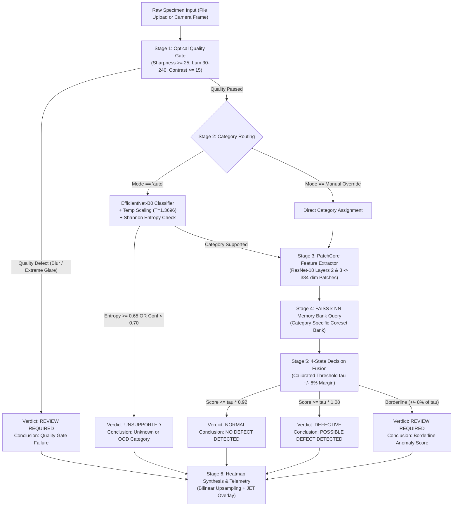

# DefectVision AI — Industrial Visual Anomaly Detection & Surface Inspection Platform
### Release Candidate: `v1.0.0-rc1` (Research Prototype)

[](https://github.com/suryacharan945/DefectVision-AI/releases/tag/v1.0.0-rc1)
[](LICENSE)
[](https://www.python.org/)
[](https://react.dev/)
[](https://pytorch.org/)
[](https://github.com/facebookresearch/faiss)
[](https://fastapi.tiangolo.com/)
[](tests/)

> **IMPORTANT SCIENTIFIC DISCLAIMER:**  
> **DefectVision AI v1.0.0-rc1 is an academic research prototype and open-source benchmark.** It is evaluated on the international MVTec AD benchmark under controlled imaging conditions. It is **NOT** a certified production factory quality assurance system and has **NOT** undergone industrial factory qualification across uncontrolled manufacturing environments.

---

## 1. Project Description

**DefectVision AI** is an industrial visual anomaly detection and surface inspection system designed to detect, localize, and triage manufacturing defects across 15 industrial product categories without requiring thousands of defective training examples.

By integrating deep unsupervised patch representation modeling (**PatchCore**) with fast nearest-neighbor search (**FAISS**), automated category recognition (**EfficientNet-B0**), an optical image quality gate, and an auditable 4-state decision boundary, DefectVision AI delivers a zero-click inspection pipeline for both single-image analysis and batch processing.

---

## 2. Problem Statement

Modern manufacturing environments face two major computer vision challenges:
1. **Defect Scarcity:** Defective parts represent a tiny fraction of production ($< 0.1\%$). Supervised object detectors (e.g., YOLO, Mask R-CNN) require thousands of labeled defect examples, making them impractical for new product introductions or zero-defect regimes.
2. **Multi-SKU Inspection Friction:** Traditional vision software requires line operators to manually reconfigure inspection profiles for different product lines. When mixed parts appear on a shared conveyor, operator error or incorrect model routing leads to catastrophic false rejection rates.

---

## 3. Main Objectives

- **Unsupervised Anomaly Modeling:** Train exclusively on nominal (defect-free) reference images to learn normal physical variation.
- **Zero-Click Category Routing:** Automatically recognize which of the 15 supported categories is presented, dispatching the image to the correct resident memory bank.
- **Real-Time Heatmap Localization:** Generate spatial heatmaps pinpointing the exact location, extent, and severity of surface defects.
- **Optical Degradation Safeguards:** Intercept out-of-focus, motion-blurred, underexposed, or glare-saturated frames before computational inference.
- **Auditable Triage:** Enforce a calibrated $\pm 8\%$ borderline guard band (`REVIEW REQUIRED`) to route uncertain specimens to human QA inspectors.

---

## 4. Key Features

- **15 Category PatchCore Memory Banks:** Pre-trained and calibrated memory banks for all 15 MVTec AD categories (10 objects, 5 textures).
- **Automated Category Recognition:** EfficientNet-B0 classifier with temperature calibration ($T = 1.3696$) and Shannon entropy out-of-distribution (OOD) rejection.
- **Optical Image Quality Gate:** Classical Laplacian variance ($\sigma^2 \ge 25$) and luminance/contrast gating.
- **Dual Inference Modes:** Drag-and-drop manual image upload or automated stream intake.
- **Batch Processing:** Asynchronous multi-image inspection queue via `/batch`.
- **Interactive Heatmap Viewport:** Dual-pane inspection viewer with dynamic alpha-blending slider.
- **Production Profiles:** Configurable per-line inspection profiles (`bottle_001_station_01`).
- **Audit Ring-Buffer History:** Thread-safe in-memory inspection history log.

---

## 5. System Architecture



For complete technical specifications, see [`docs/ARCHITECTURE.md`](docs/ARCHITECTURE.md).

---

## 6. Technology Stack

- **Backend Framework:** FastAPI 0.100+, Uvicorn ASGI server.
- **Deep Learning Framework:** PyTorch 2.1+, Torchvision, Timm.
- **Nearest-Neighbor Engine:** FAISS (Facebook AI Similarity Search) CPU 1.7+.
- **Computer Vision:** OpenCV (`cv2`), Albumentations, NumPy.
- **Frontend Framework:** React 19, Vite 8, Tailwind CSS, Lucide Icons.
- **Testing & QA:** Python `unittest`, Vite build verification.

---

## 7. Model Descriptions

| Category | Type | Memory Bank Tokens | Feature Dim | Memory Bank Size | Calibrated Threshold ($\tau$) |
|---|---|---:|---:|---:|---:|
| **bottle** | Object | 14,739 | 384 | 22.6 MB | 1.4666 |
| **cable** | Object | 15,758 | 384 | 24.2 MB | 2.4577 |
| **capsule** | Object | 15,444 | 384 | 23.7 MB | 1.1502 |
| **carpet** | Texture | 19,756 | 384 | 30.3 MB | 1.3543 |
| **grid** | Texture | 18,580 | 384 | 28.5 MB | 1.4634 |
| **hazelnut** | Object | 27,518 | 384 | 42.3 MB | 2.3403 |
| **leather** | Texture | 17,248 | 384 | 26.5 MB | 1.1136 |
| **metal_nut** | Object | 15,523 | 384 | 23.8 MB | 1.8271 |
| **pill** | Object | 18,816 | 384 | 28.9 MB | 1.7575 |
| **screw** | Object | 22,579 | 384 | 34.7 MB | 1.4684 |
| **tile** | Texture | 16,228 | 384 | 24.9 MB | 1.4735 |
| **toothbrush** | Object | 4,233 | 384 | 6.5 MB | 1.4593 |
| **transistor** | Object | 14,974 | 384 | 23.0 MB | 1.7787 |
| **wood** | Texture | 17,404 | 384 | 26.7 MB | 1.3440 |
| **zipper** | Object | 16,934 | 384 | 26.0 MB | 1.1627 |

Full model details are documented in [`docs/MODEL_DOCUMENTATION.md`](docs/MODEL_DOCUMENTATION.md).

---

## 8. Dataset Information

The primary evaluation benchmark is **MVTec AD** (Bergmann et al., 2019):
- **15 Categories:** 5 textures and 10 objects.
- **Training Set:** 3,629 defect-free nominal images.
- **Evaluation Test Set:** 1,725 total images (467 normal, 1,258 defective across 73 defect types).
- **Pill Benchmark Test Specimen Audit:** Forensically verified at 77 total test specimens (26 normal, 25 color defect, 26 crack defect).

Dataset specifications are documented in [`docs/DATASET_AND_PREPROCESSING.md`](docs/DATASET_AND_PREPROCESSING.md).

---

## 9. Installation Instructions

```bash
# 1. Clone repository
git clone https://github.com/suryacharan945/DefectVision-AI.git
cd DefectVision-AI

# 2. Create Python virtual environment
python -m venv .venv
# On Windows:
.\.venv\Scripts\Activate.ps1
# On Linux/macOS:
source .venv/bin/activate

# 3. Install Python dependencies
pip install -r requirements.txt

# 4. Install Frontend dependencies
npm --prefix frontend install
```

Detailed setup instructions are documented in [`docs/INSTALLATION_AND_SETUP.md`](docs/INSTALLATION_AND_SETUP.md).

---

## 10. Backend Startup

On Windows (PowerShell):
```powershell
Set-Location "DefectVisionAI"
& "..\.venv\Scripts\python.exe" -m uvicorn app:app --host 127.0.0.1 --port 8001
```

On Linux / macOS:
```bash
cd DefectVisionAI
../.venv/bin/python -m uvicorn app:app --host 127.0.0.1 --port 8001
```

Verify backend health at `http://127.0.0.1:8001/health`.

---

## 11. Frontend Startup

In a separate terminal:
```bash
npm --prefix frontend run dev
```

Open `http://127.0.0.1:5174` in your browser.

---

## 12. Configuration Requirements

- **Port Bindings:** Backend expects port `8001`; Frontend runs on port `5174` (or `5173`).
- **OpenMP Settings:** On Windows, `KMP_DUPLICATE_LIB_OK="TRUE"` is enforced automatically in `app.py` to prevent multi-threading runtime crashes.
- **Model Storage:** All memory banks and weights must reside in `DefectVisionAI/models/`.

---

## 13. Inference Workflow

1. **Upload:** User drops an image into the inspection zone.
2. **Quality Check:** System validates sharpness, exposure, and contrast.
3. **Classification:** EfficientNet-B0 determines category.
4. **Scoring:** ResNet-18 features are extracted and matched against FAISS memory bank.
5. **Verdict:** Score compared to calibrated threshold; interactive heatmap synthesized.

Detailed lifecycle steps are documented in [`docs/INFERENCE_WORKFLOW.md`](docs/INFERENCE_WORKFLOW.md).

---

## 14. Evaluation Results & Research Findings

### 14.1 Full-Dataset Production Benchmark (1,725 Test Images across 15 Categories)
- **Macro Image-Level AUROC:** **97.15%** (unweighted arithmetic mean across all 15 MVTec AD classes).
- **Macro Image-Level AUPRC:** **98.98%**.
- **Reported Pixel-Level AUROC:** **98.02%** (mean localization AUROC on defective masks).
- **15-Class Product Category Recognition:** **99.94%** accuracy ($1,724 / 1,725$ correct SKU routing; 1 texture misclassified with high entropy).
- **Historical Supervised Binary Defect Baseline:** **86.92%** accuracy ($764 / 856$ specimens evaluated on supervised defect detection in Phase 51/53; 111 defects missed).
- **Micro Defect Sensitivity (All 1,725 Images):** **94.04%** ($1,183 / 1,258$ defects detected; Macro Recall: **95.40%**).
- **Micro False Positive Rate (FPR):** **24.84%** ($116 / 467$ nominal images flagged; Macro FPR: **29.04%**).
- **Micro F1-Score:** **0.9253** (Macro F1: **0.9240**).
- **Overall Image Accuracy:** **88.93%** ($1,534 / 1,725$ decisions correct under operational thresholds).

### 14.2 Few-Shot In-Domain Adaptation (Bottle Benchmark, N=83 Test Images)
- **K=10 (Frozen Policy $\tau = \max(S_{\text{cal}})$):** FPR: **0.00%** [Clopper-Pearson 95% Exact CI: $0.00\%, 16.84\%$; Wilson CI: $0.00\%, 16.11\%$], Recall: **96.83%**, F1: **0.9839**. *(Designated as Primary Few-Shot Benchmark)*.
- **K=20 (Frozen Policy $\tau = \max(S_{\text{cal}})$):** FPR: **20.00%** ($4/20$ false alarms), Recall: **100.00%**, F1: **0.9692**.
- **K=20 (Post-Hoc Multiplier $1.20\times$):** FPR: **0.00%**, Recall: **100.00%**, F1: **1.0000**. *(Formally classified as a DEVELOPMENT-SET RESULT; rejected for production deployment due to threshold leakage)*.

### 14.3 Spatial-Photometric Feature Fusion Audit
- **Result:** **FAILED OPERATIONAL TARGETS.** Concatenating 384 deep CNN features with 3 color features suppressed color distance to $< 2.0\%$ of total Euclidean distance. Best color defect recall was only $24.0\%$.

### 14.4 External Factory Adaptation (Track B)
- **Status:** **`BLOCKED — DATA REQUIRED`**. The current external dataset contains only 1 physical defect specimen; factory adaptation claims cannot be scientifically supported without $N \ge 300$ normal and $N \ge 30$ defect units.

---

## 15. Known Limitations

1. **Photometric Blindness:** Low sensitivity to subtle color-only changes due to ImageNet spatial feature dominance.
2. **Few-Shot Variance:** Small calibration sets ($N=10$) suffer from sampling noise in empirical maximums.
3. **Specimen Independence vs. File Uniqueness:** Evaluated samples represent unique image captures with verified SHA-256 hashes; unique file hashes guarantee byte-level separation across splits but do not guarantee separate physical manufacturing units.
4. **External Domain Shift:** Degrades on uncontrolled smartphone images with varying lighting or background clutter.
5. **Throughput:** CPU inference ($110 - 165 \text{ ms}$) is suitable for low-to-medium speed inspection; high-speed lines require GPU acceleration.

Complete details in [`docs/LIMITATIONS_AND_FUTURE_WORK.md`](docs/LIMITATIONS_AND_FUTURE_WORK.md).

---

## 16. Repository Structure

```
DefectVision-AI/
├── DefectVisionAI/            # FastAPI backend & optical inference engine
│   ├── app.py                 # Service entrypoint
│   ├── src/                   # Core Python algorithms (PatchCore, Classifier, Router)
│   ├── models/                # 15 category memory banks, FAISS indexes & thresholds
│   └── dataset/               # MVTec AD dataset directory
├── frontend/                  # React + Vite user interface
│   ├── src/                   # Components, API client, hooks, context & styling
│   └── vite.config.js         # Build configuration
├── tests/                     # 92 unit and integration tests
├── docs/                      # Technical documentation
├── release/                   # Formal release audits, CSV datasets & research reports
│   ├── audits/                # Integrity, regression & git verification reports
│   └── experiments/           # Audited CSV datasets & threshold audit reports
└── scripts/                   # Auditing, evaluation & maintenance automation scripts
```

---

## 17. Demonstration and Verification Guide

To execute a local end-to-end demonstration using genuine MVTec AD specimens:
1. Ensure backend is running on `http://127.0.0.1:8001` and frontend on `http://127.0.0.1:5174`.
2. Inspect nominal bottle: `release/portfolio_handover/assets/04_genuine_specimen_raw_bottle_nominal.png` $\rightarrow$ Result: `NORMAL`.
3. Inspect defective bottle: `release/portfolio_handover/assets/01_genuine_specimen_raw_bottle_defective.png` $\rightarrow$ Result: `DEFECTIVE` with heatmap overlay.
4. Run automated test suite: `.\.venv\Scripts\python -m unittest discover tests`.

---

## 18. Future Work

- **Decoupled Dual-Stream Architecture:** Separate spatial ($\mathbb{R}^{384}$) and photometric ($\mathbb{R}^3$) memory banks with max-ratio score fusion ($s_{\text{fused}} = \max(s_s/\tau_s, s_c/\tau_c)$).
- **Self-Supervised Vision Transformers:** Replace supervised CNNs with DINOv2 backbones.
- **Extreme Value Theory (EVT):** Parameterize threshold margins via Weibull tail modeling.
- **Edge Deployment:** TensorRT and ONNX Runtime compilation for embedded NVIDIA Jetson platforms.

---

## 19. License and Citation

This project is licensed under the MIT License. See [LICENSE](LICENSE) for details.

### Citation
```bibtex
@misc{defectvision_ai_2026,
  author = {Surya Charan},
  title = {DefectVision AI: Benchmark-Evaluated Industrial Anomaly Detection Research Prototype},
  year = {2026},
  publisher = {GitHub},
  howpublished = {\url{https://github.com/suryacharan945/DefectVision-AI}},
  note = {Release Candidate v1.0.0-rc1}
}
```
