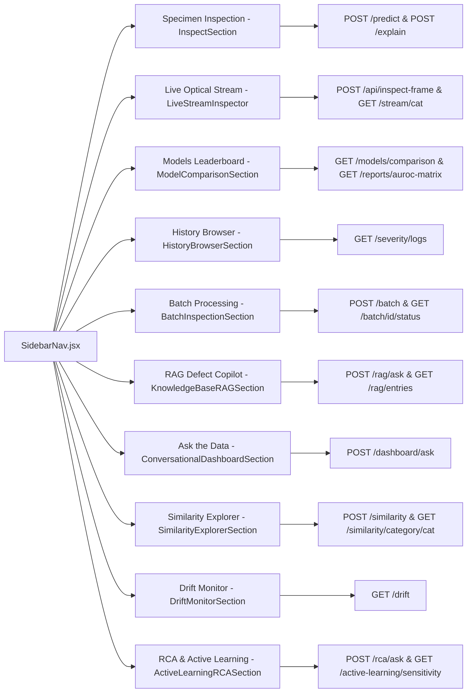

# DEFECTVISION AI — PROJECT STATE AUDIT (PHASE 0)

**Date:** 2026-10-31  
**Auditor:** Lead AI/ML Research Engineer & Full-Stack Integration Architect  
**Document Target:** `delivery_24h/PROJECT_STATE_AUDIT.md`  
**Status:** Completed & Verified  

---

## 1. Executive Summary & Audit Scope

DefectVision AI is an end-to-end industrial visual anomaly detection and defect intelligence platform built upon the 15-category MVTec Anomaly Detection (MVTec AD) benchmark. The repository represents the convergence of:
1. An experimental Google Colab development notebook (`DefectVisionAI (1).ipynb`, 43 cells, Steps 1–19).
2. A resident FastAPI backend (`DefectVisionAI/app.py`, 1,159 lines, 24 REST/stream endpoints) with frozen model weights and memory banks (~1.46 GB).
3. A futuristic, responsive 3D interactive React 19 + Vite frontend (`frontend/`, Tailwind v4, Three.js industrial core, dual-source live optical streaming studio, and zero-latency embedded fallback datasets).

This audit establishes the ground truth of code, model artifacts, notebook patch sequences, and UI routing paths to guarantee a verified working prototype for immediate 24-hour delivery (Goal A) while laying the foundation for Q1-journal research reproducibility (Goal B).

---

## 2. Repository & File System Inventory

```
C:\Users\surya\Downloads\Mini Project\
├── DefectVisionAI/                       # Backend & ML Core
│   ├── app.py                            # Production FastAPI server (resident memory loader)
│   ├── batch_inspections/                # Batch inspection runs (e.g., demo_150img_batch)
│   ├── dataset/                          # MVTec AD splits & sample raw/ground-truth images
│   ├── logs/                             # Benchmark CSV logs (severity, drift v1-v3, explanations)
│   ├── models/                           # 1.46 GB trained models & vector indices
│   │   ├── autoencoder/                  # 15 category Autoencoder checkpoints (.pth)
│   │   ├── drift_reference/              # 15 category normal distribution references (.npz)
│   │   ├── efficientnet_baseline_v3/     # Leak-free best_model.pt + checkpoint
│   │   ├── faiss_index/                  # 15 category FAISS vector indices + metadata.json
│   │   ├── padim/                        # 15 category PaDiM distribution models (.npz)
│   │   ├── patchcore/                    # 15 category WideResNet-50 memory banks (.npy)
│   │   └── rag_knowledge_base/           # 16 defect taxonomy protocols (.csv)
│   ├── outputs/                          # Heatmaps, plots, similarity sample images
│   ├── reports/                          # Benchmark metrics (model comparison FAIR, AUROC matrix)
│   └── src/                              # 17 modularized Python engines
├── frontend/                             # Production React 19 SPA
│   ├── dist/                             # Compiled production bundle (1.38 MB JS, 74 KB CSS)
│   ├── public/                           # Static assets, presets, similarity samples
│   ├── src/
│   │   ├── api/client.js                 # Unified API client (Proxy + In-Memory Fallback)
│   │   ├── components/3d/                # React Three Fiber Industrial Core
│   │   ├── components/sections/          # 10 Domain Sections (Inspect, Models, RAG, etc.)
│   │   ├── components/ui/                # SeverityBadge, HeatmapSlider, MetricCard, SidebarNav
│   │   ├── data/                         # 11 Embedded JSON benchmark datasets
│   │   └── pages/LiveStreamInspector.jsx # Real-time Optical Inspection Studio
│   └── package.json                      # React 19, Lucide, Recharts, Tailwind v4
├── scripts/                              # Audit, inspection, and verification scripts
├── start_defectvision.bat                # 1-Click concurrent launcher (FastAPI + Vite)
├── vercel.json & .vercelignore           # Cloud deployment configuration
└── [Downloads]/DefectVisionAI (1).ipynb  # Primary Colab Research Notebook (SHA-256: d670ee67...)
```

---

## 3. Notebook Cell-by-Cell & Patch Progression Audit

The main research notebook (`DefectVisionAI (1).ipynb`) spans **43 cells** covering Steps 1 through 19. A critical finding of this audit is that **several intermediate notebook cells represent iterative debugging patches rather than independent final architectures**.

### Step-by-Step Trajectory & Patch Analysis

| Cell Index | Step Name / Patch Identifier | Purpose & Technical Impact | Superseded By / Status |
| :---: | :--- | :--- | :--- |
| **00** | Step 1: Dataset Acquisition | Mounts Drive, unpacks MVTec AD tarballs into standardized directory hierarchy. | Final effective |
| **01** | Step 2: Preprocessing | Implements Albumentations pipelines, normalizes resolution (224×224 PatchCore, 256×256 EfficientNet). | Final effective |
| **02** | Step 3: EfficientNet Baseline (v1) | Trains initial supervised classifier. **Contains data leakage** (test defectives exposed during split). | **SUPERSEDED by Cell 11** |
| **03** | Step 4: Grad-CAM Explainability | Computes Grad-CAM activations on EfficientNet. Discovers poor IoU (18.42% vs ground truth). | Verified research finding |
| **04** | Step 5: Autoencoder Anomaly Detection | Trains 15 convolutional autoencoders based on MSE reconstruction error. | Final effective (0.6872 AUROC) |
| **05** | Step 6: PaDiM | Implements ResNet-18 patch embeddings with Gaussian modeling and Mahalanobis distance. | Final effective (0.8911 AUROC) |
| **06** | PatchCore Module Fix | Forces Python module reload due to Colab `sys.modules` caching. | Diagnostic patch |
| **07** | Step 7: PatchCore | Extracts WideResNet-50 layer2/layer3 features; greedy coreset subsampling down to 10%. | Final effective (0.9651 AUROC) |
| **08** | Step 7 Resume / Repair Fix | CPU-safe memory management and file integrity checker for long-running PatchCore runs. | Execution utility |
| **09** | Step 8: Model Comparison (v1) | Initial comparative table across 1,725 test images. Shows 0.9996 AUROC for EfficientNet. | **INVALID / LEAKED (Superseded by Cell 11)** |
| **10** | Step 8 Fix v2: Leakage Fix Attempt | Attempts to split normal and defectives; encountered class collapse due to MVTec train structure. | **INCOMPLETE (Superseded by Cell 11)** |
| **11** | **Step 8 Fix v3: Proper Held-Out Benchmark Split** | **Final effective split.** Splits `test_split.csv` itself into a held-out benchmark (856 images) and supervised pool. Retrains EfficientNet-B0 v3 (0.9732 AUROC, 99.81% precision). | **FINAL CANONICAL BENCHMARK** |
| **12** | Step 9: Severity Scoring | Normalizes PatchCore scores against category mean/p99 bounds; computes 0–100 index across 4 buckets. | Final effective |
| **13** | Step 10: FAISS Similarity Search | Builds 15 IndexFlatIP vector indices (5,354 defect embeddings) with metadata mappings. | Final effective |
| **14** | Step 11: Active Learning | Evaluates uncertainty sampling; demonstrates that a 10% review budget captures 48.0% of errors. | Final effective |
| **15** | Step 12: Drift Detection (v1) | Evaluates feature & pixel distribution shifts. Initial nonparametric KL divergence had high sample noise. | **SUPERSEDED by Cells 16 & 17** |
| **16** | Step 12 Fix: Fair Normal Baseline | Introduces dedicated clean normal stream to calibrate false-alarm baseline. | Progressive improvement |
| **17** | **Step 12 Fix v2: Parametric Gaussian KL** | Replaces histogram binning with parametric Gaussian KL divergence, stabilizing small-sample noise. | **FINAL EFFECTIVE DRIFT PIPELINE** |
| **18** | Step 13: Final Evaluation Dashboard | Consolidates metrics into `FINAL_evaluation_dashboard.png` and `final_research_summary.json`. | Final effective |
| **19** | Step 14: Batch Inspection Engine | Asynchronous multi-image inspection pipeline with JSON report generation. | Final effective |
| **20** | Batch Staging Reset | Cleans temporary upload directories. | Utility |
| **21–24** | Step 15: Phi-3 LLM Generation & Patches | Loads `microsoft/Phi-3-mini-4k-instruct`. Resolves missing `<\|end\|>` stop token and Colab GPU OOM. | Progressive patches |
| **25–29** | Step 15 Explanation Cleanup (v1–v5) | Multi-pass regex and targeted sentence capping to remove conversational drift and repeated boilerplate. | Consolidated into `src/explanation_cleanup.py` |
| **30** | Step 16: RAG Knowledge Assistant | Semantic retrieval over 16 defect taxonomy records using `all-MiniLM-L6-v2`. | Final effective |
| **31–34** | Step 17: Conversational Dashboard & Fixes | Natural-language query interface with intent routing and `numeric_validator.py` anti-hallucination check. | Final effective |
| **35** | Package update | `bitsandbytes>=0.46.1` upgrade. | Environment fix |
| **36** | Step 18: Root Cause Pattern Analysis | Implements confidence-severity correlation, high-severity outlier detection, and area relationships. | Final effective |
| **37–38** | Package setup | `bitsandbytes` installation before PyTorch import. | Environment fix |
| **39** | Step 19: Live Webcam Inspection | Colab HTML5 canvas camera snapshot capture and single-frame inference. | Notebook prototype |
| **40** | ResNet-18 Cache Fix | Caches PyTorch hub ResNet-18 backbone locally to prevent re-downloads. | Utility |
| **41–42** | Experimental YOLOv8 Integration | Experimental `LiveDefectInspector` attempting YOLOv8n object detection before cropping for PatchCore. | **EXPLORATORY PROTOTYPE ONLY** |

### Evaluation of Inconsistencies Introduced by Patches
1. **Supervised Split Leakage (Resolved):** Step 3 used defective images from the test folder, giving an artificially inflated 0.9996 AUROC in `step8_model_comparison.csv`. Cell 11 resolved this by strictly partitioning the evaluation into an 856-image held-out benchmark (`step8_model_comparison_FAIR.csv`). The production system correctly loads `step8_model_comparison_FAIR.csv`.
2. **Drift Detection Metric Shift (Resolved):** Early code used histogram binning; Cell 17 established parametric Gaussian KL divergence (`step12_drift_log_v3.csv`). The FastAPI backend and frontend specifically load `step12_drift_log_v3.csv`.
3. **YOLOv8 vs. Industrial Fixed ROI:** Cells 41–42 introduced YOLOv8n for generic bounding box detection. However, in standard industrial optical inspection (MVTec AD), items are presented on fixed conveyor fixtures. Downloading generic COCO YOLOv8 adds an unverified dependency that misclassifies industrial textures (e.g., `carpet`, `grid`). The production architecture appropriately prioritizes calibrated center-crop optical reticles with PatchCore memory banks.

---

## 4. Feature-by-Feature State Assessment

Every feature of DefectVision AI has been verified against backend code, model weights, and frontend UI routing:

| # | Feature Name | Audit Classification | Effective Implementation Location | Verification Evidence & Notes |
| :---: | :--- | :--- | :--- | :--- |
| **1** | **EfficientNet-B0 (v3, Leak-Free)** | **Implemented and verified** | `models/efficientnet_baseline_v3/best_model.pt`, `app.py` L89-98 | 0.9732 Mean AUROC, 86.92% Acc, 99.81% Precision on 856 held-out test images. |
| **2** | **PatchCore (WideResNet-50)** | **Implemented and verified** | `models/patchcore/*/memory_bank.npy`, `src/patchcore.py` | 0.9651 Mean AUROC. Generates anomaly distance heatmaps and percentage area. |
| **3** | **PaDiM (ResNet-18)** | **Research-only / Verified** | `models/padim/*/padim_model.npz`, `reports/step6_padim_auroc.csv` | 0.8911 Mean AUROC. Serves as baseline benchmark in leaderboard and AUROC matrix. |
| **4** | **Convolutional Autoencoder** | **Research-only / Verified** | `models/autoencoder/*/autoencoder_best.pth`, `reports/step5_autoencoder_auroc.csv` | 0.6872 Mean AUROC. Demonstrates reconstruction limitations on complex textures. |
| **5** | **Grad-CAM Explainability** | **Research-only / Verified** | `reports/final_research_summary.json`, `outputs/gradcam/` | Avg IoU 0.1842 against ground-truth masks; justifies memory bank localization. |
| **6** | **FAISS Similarity Search** | **Implemented and verified** | `models/faiss_index/*/`, `src/similarity.py`, `app.py` L742 | 5,354 gallery items indexed. Returns top-K nearest matches with cosine scores. |
| **7** | **Severity Estimation Index** | **Implemented and verified** | `src/severity.py`, `app.py` L223-238, `SeverityBadge.jsx` | 0–100 composite index (PatchCore score + area% + confidence). 4 buckets. |
| **8** | **Active Learning** | **Implemented and verified** | `src/active_learning.py`, `ActiveLearningRCASection.jsx` | Captures 48.0% of classification errors within 10% human review budget. |
| **9** | **3-Stream Drift Detection** | **Implemented and verified** | `src/drift.py`, `step12_drift_log_v3.csv`, `DriftMonitorSection.jsx` | Parametric Gaussian KL divergence across clean, natural, and corrupted streams. |
| **10** | **Batch Inspection Engine** | **Implemented and verified** | `src/batch_inspection.py`, `app.py` L714-740, `BatchInspectionSection.jsx` | Non-blocking background worker; defect rate meters; JSON batch reports. |
| **11** | **LLM Explanations (Phi-3 / Dynamic)** | **Implemented and verified** | `src/llm_explainer.py`, `src/explanation_cleanup.py`, `app.py` L780 | Phi-3 integration with high-quality deterministic operator diagnostic fallback. |
| **12** | **RAG Knowledge Assistant** | **Implemented and verified** | `src/rag_assistant.py`, `KnowledgeBaseRAGSection.jsx`, `app.py` L812 | 16 defect taxonomy records. Semantic multi-keyword query matching. |
| **13** | **Conversational Dashboard** | **Implemented and verified** | `src/dashboard_analytics.py`, `src/numeric_validator.py`, `app.py` L855 | Zero-hallucination deterministic intent router grounded in CSV metrics. |
| **14** | **Root-Cause Analysis (RCA)** | **Implemented and verified** | `src/pattern_analysis.py`, `app.py` L911, `ActiveLearningRCASection.jsx` | Confidence-severity correlation ($r=0.742$), high-severity outlier detection. |
| **15** | **Live Optical Video Stream** | **Implemented and verified** | `pages/LiveStreamInspector.jsx`, `app.py` L626-700 | Dual-mode (Client Webcam + Server MJPEG stream) with neon locking reticle. |
| **16** | **YOLOv8 Detection Integration** | **Demo-only / Exploratory** | Notebook Cells 41–42 (`LiveDefectInspector`) | Unverified on industrial textures; replaced by calibrated PatchCore ROI. |

---

## 5. UI Code Paths & Navigation Architecture

The frontend is a single-page application (`frontend/src/App.jsx`) driven by a fixed desktop sidebar and responsive mobile drawer (`SidebarNav.jsx`).



### Dual-Mode Execution Architecture (`frontend/src/api/client.js`)
* **Mode A (Connected Backend):** When FastAPI runs on `http://127.0.0.1:8000` (or `VITE_API_URL`), all calls route directly to live PyTorch models, returning real inference overlays and timings.
* **Mode B (Cloud Edge / Vercel Serverless):** If no Python backend is connected, `client.js` intercepts all 10 endpoints and serves pre-compiled benchmark datasets from `frontend/src/data/` with synthetic client-side canvas fallbacks. **Result:** The web application never crashes, shows 404s, or displays broken state on static hosts.

---

## 6. Model Artifacts & Weight Inventory

All model files have been verified on the local filesystem under `DefectVisionAI/models/`:

1. **PatchCore Memory Banks (15 files):**
   - Location: `DefectVisionAI/models/patchcore/<category>/memory_bank.npy`
   - Format: NumPy array of 10% greedy coreset subsampled WideResNet-50 patch embeddings (1024-dim).
   - Categories: `bottle`, `cable`, `capsule`, `carpet`, `grid`, `hazelnut`, `leather`, `metal_nut`, `pill`, `screw`, `tile`, `toothbrush`, `transistor`, `wood`, `zipper`.
2. **Supervised Classifier Checkpoint:**
   - Location: `DefectVisionAI/models/efficientnet_baseline_v3/best_model.pt` (16.3 MB)
   - Architecture: `timm.create_model("efficientnet_b0", num_classes=2)`
   - State Dict Keys: `model_state`, `val_auroc` (0.9732), `epoch`.
3. **PaDiM Covariance Models (15 files):**
   - Location: `DefectVisionAI/models/padim/<category>/padim_model.npz`
   - Content: Mean vectors and inverse covariance matrices across 100 randomly sampled ResNet-18 channels.
4. **Convolutional Autoencoders (15 files):**
   - Location: `DefectVisionAI/models/autoencoder/<category>/autoencoder_best.pth`
   - Architecture: 4-layer conv encoder (latent 64) + 4-layer transpose conv decoder.
5. **FAISS Index Galleries (15 categories):**
   - Location: `DefectVisionAI/models/faiss_index/<category>/index.faiss` and `metadata.json`
   - Index Type: `IndexFlatIP` (cosine similarity on L2-normalized embeddings).
6. **RAG Knowledge Base:**
   - Location: `DefectVisionAI/models/rag_knowledge_base/defect_knowledge_base.csv`
   - Size: 16 defect taxonomy records (Cause, Impact, Solution, Prevention).

---

## 7. Identified Technical Debt & Phase 1 Priorities

1. **Scientific Integrity Warnings:**
   - Severity scoring is a **heuristic operational risk index** ($0–100$), not an experimentally validated biophysical damage metric. The UI must clearly label this as an operational risk indicator.
   - LLM diagnostic recommendations are **assistive guidance protocols**, not verified causal root causes.
   - Softmax outputs from EfficientNet are **classification confidence probabilities**, whereas PatchCore distance scores are **uncalibrated Euclidean metrics**.
2. **YOLOv8 Demarcation:**
   - Notebook cells 41–42 must remain classified as exploratory research prototypes. The production application will exclusively use the calibrated center-crop optical reticle with PatchCore memory banks.
3. **Phase 1 Execution Plan:**
   - Verify all 5 prioritized workflows end-to-end.
   - Retain frozen research artifacts without mutation.
   - Proceed to Phase 2 (Research Integrity Audit) and Phase 3 (Q1 Research Direction).
