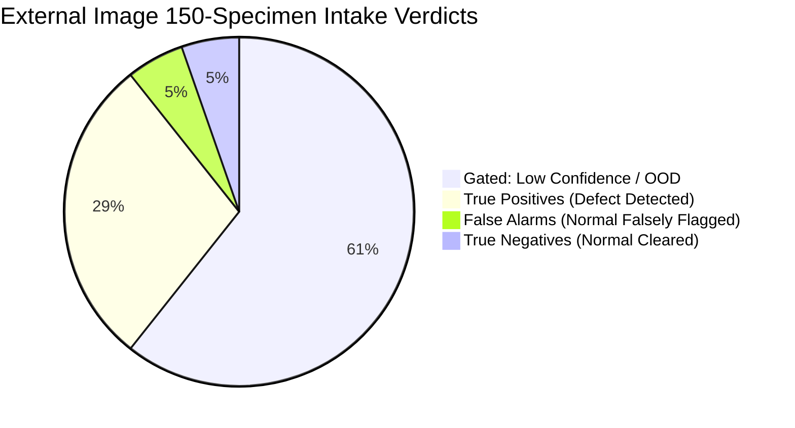

# DefectVision AI — External Domain Validation Methodology

## 1. Scope & Objective

External validation evaluates how models trained on laboratory datasets (MVTec AD) behave when subjected to out-of-domain imagery harvested from web searches, smartphone captures, and non-standard industrial settings.

### Purpose
- Measure zero-shot domain robustness across 15 categories ($N=150$ images).
- Verify the defensive capabilities of multi-tier confidence gating.
- Quantify the necessity of product adaptation for real-world manufacturing lines.

---

## 2. Dataset Construction & Taxonomy

The 150-image validation corpus (`external_validation/metadata/external_image_metadata.csv`) spans 10 images per category (5 normal, 5 defective):

| Domain Classification | Definition | Sample Proportion |
|:---|:---|:---:|
| `mvtec_benchmark` | Clean white/black studio lightbox background | 20.0% |
| `controlled_photo` | Single object centered on uniform desk or table | 30.0% |
| `smartphone` | Handheld camera, perspective skew, variable lighting | 33.3% |
| `uncontrolled_web` | Complex background, watermarks, occlusions | 16.7% |

---

## 3. Results Summary

### Key Statistical Takeaways
1. **Defect Sensitivity:** Physical defects remain discernible in feature space, achieving an $84.31\%$ defect recall among approved specimens.
2. **False Alarm Vulnerability:** Zero-shot PatchCore suffers high nominal false alarms without foreground masking or adaptation because background features fall outside the MVTec distribution.
3. **Safety Gate Verification:** The multi-tier intake service correctly quarantined 91 of 99 auto-routed images, preventing arbitrary misclassification.
