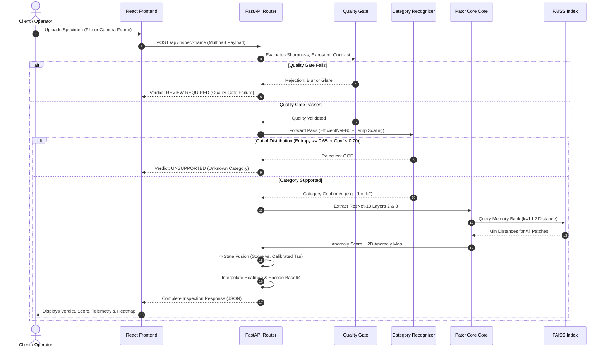

# DefectVision AI — Inference Workflow & Execution Lifecycle
**Release:** v1.0.0-rc1 (Research Prototype)  
**Date:** 2026-11-19  

---

## 1. Inspection Lifecycle Sequence

When an image is submitted to the DefectVision AI platform, it transitions through eight discrete execution phases:

---

## 2. Phase Breakdown

### Phase 1: Intake & Buffer Decoding
The image binary is received in memory, avoiding disk I/O bottlenecks. OpenCV decodes the byte array into a NumPy BGR tensor. If the byte stream is malformed or empty, execution aborts with HTTP 400.

### Phase 2: Optical Quality Gate
The image is converted to grayscale to compute:
1. **Laplacian Variance:** $\sigma^2(\nabla^2 I) = \frac{1}{HW} \sum (L_{ij} - \bar{L})^2$. If $< 25.0$, image is blurred.
2. **Mean Luminance:** $\bar{I} = \frac{1}{HW} \sum I_{ij}$. If $< 30$ (underexposed) or $> 240$ (overexposed), image is degenerate.
3. **Contrast:** Std deviation of luminance. If $< 15.0$, image lacks dynamic range.

### Phase 3: Category Recognition & OOD Guard
In automated mode, the image is scaled to $224 \times 224$ and passed through EfficientNet-B0:
- Output logits are scaled by temperature $T = 1.3696$.
- Softmax yields class probabilities. Normalized Shannon entropy is evaluated.
- If entropy $\ge 0.65$ or top confidence $< 0.70$, the request terminates early with `verdict: "UNSUPPORTED"`, protecting memory banks from irrelevant data.

### Phase 4: Patch Representation Extraction
The validated image is processed through ResNet-18:
- Activations from `layer2` (stride 8) and `layer3` (stride 16) are extracted.
- Local spatial average pooling ($3 \times 3$) aggregates contextual neighborhood information.
- Feature maps are aligned and concatenated along the channel axis to create $28 \times 28 = 784$ patch tokens of dimension 384.

### Phase 5: FAISS Nearest-Neighbor Search
The patch tokens $\mathbf{f}_p \in \mathbb{R}^{384}$ are queried against the resident category memory bank $\mathcal{M}_c$:
- The query computes $L_2$ distances to the nearest nominal patches.
- The maximum distance among all patches determines the primary anomaly score:
  $$s(I) = \max_{p \in \mathcal{P}} d(p, \mathcal{M}_c)$$

### Phase 6: Calibrated 4-State Decision Fusion
The computed score $s(I)$ is compared against the category's calibrated threshold $\tau_c$:
- $s(I) \le 0.92 \tau_c \implies$ **NORMAL**
- $s(I) \ge 1.08 \tau_c \implies$ **DEFECTIVE**
- $0.92 \tau_c < s(I) < 1.08 \tau_c \implies$ **REVIEW REQUIRED** (Borderline score guard band)

### Phase 7: Heatmap Synthesis
Patch distance scores are arranged on the $28 \times 28$ spatial grid, bilinearly resized to $224 \times 224$, smoothed with a Gaussian filter ($\sigma = 4.0$), and mapped to JET colormap intensities.

### Phase 8: Telemetry & UI Rendering
The inspection payload (score, threshold, verdict, latency, defect area percentage, and base64 heatmap) is returned to the client and appended to the local audit log.
