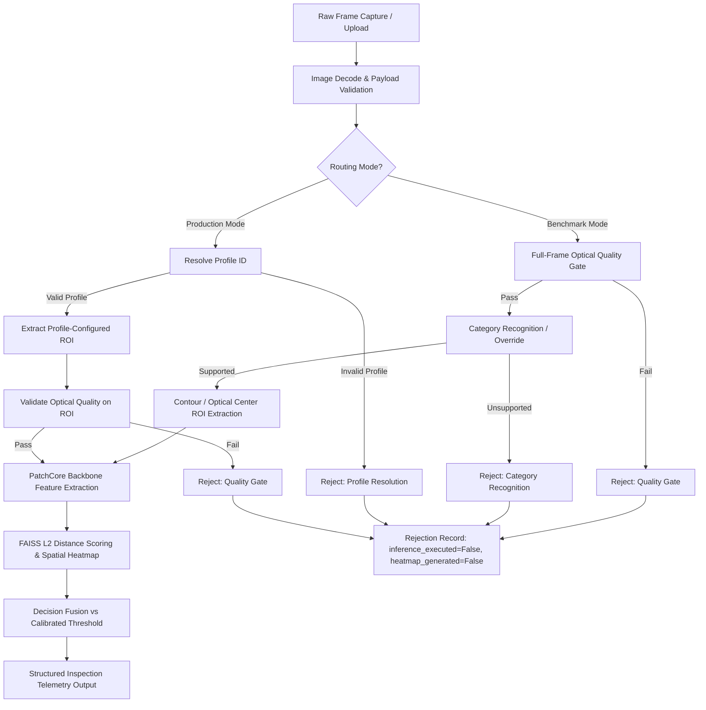

# DefectVision AI — Production Inspection Profiles & Target-Domain PatchCore Guide

## 1. Overview & Industrial Motivation

DefectVision AI operates in two complementary paradigms:

1. **Benchmark Mode (15 MVTec AD Categories)**:
   - Automatic category recognition using an EfficientNet-B0 visual classifier.
   - Routing to one of 15 canonical PatchCore memory banks trained on standard MVTec AD defect-free splits.
   - Validated against the 856-image canonical held-out benchmark dataset.
   - Ideal for standardized multi-product benchmarking and academic reproducibility.

2. **Production Mode (Target-Domain Product Profiles)**:
   - Direct, deterministic routing to a dedicated product and station profile via `profile_id`.
   - Tuned specifically to the physical camera optics, working distance, illumination geometry (e.g. diffuse backlighting, telecentric lenses), and conveyor mechanical fixtures.
   - Calibrated against defect-free normal captures from the physical inspection station, ensuring true operational reliability with bounded False Alarm Rates (FAR $\le 1\%$).
   - Completely bypasses multi-class categorization to prevent out-of-domain cross-class classification errors.

---

## 2. Pipeline Execution Order

To eliminate false alarms caused by extraneous background illumination (such as bright LED panels outside the product boundary) and to prevent misleading inference artifacts on unverified frames, the inspection pipeline strictly enforces this sequential order:



### Stage Details

1. **Image Decode & Payload Validation**:
   - In-memory decoding of JPEG/PNG payloads with zero temporary disk writes.
   - Corrupted or 0-byte frames are immediately rejected with `rejection_stage: "image_decode"`.

2. **Profile / Route Resolution**:
   - In Production Mode, the engine verifies the requested `profile_id` against registered profiles in `DefectVisionAI/models/production_profiles/`.
   - Missing or misconfigured profiles fail early with `rejection_stage: "profile_resolution"`.

3. **ROI Extraction**:
   - Extracted **before** product quality validation.
   - Uses configured fixed bounding boxes `[x, y, w, h]` or proportional boxes `relative_bbox: [rx, ry, rw, rh]` suited to mechanical conveyor guides.
   - Automatic fallback to foreground contour detection if the fixed bounding box is empty or out-of-bounds.

4. **ROI Quality Validation**:
   - Sharpness (Laplacian variance), mean luminance, contrast, and specular saturation are evaluated **strictly on the extracted product ROI**.
   - Background illumination or conveyor reflections outside the ROI cannot cause spurious quality rejections.

5. **PatchCore Feature Extraction**:
   - Frozen ResNet18 feature extractor pooling layers `layer2` (dim=128) and `layer3` (dim=256).
   - Features bilinearly interpolated and fused into 384-dimensional patch vectors on a $28 \times 28$ spatial grid.

6. **FAISS Nearest Neighbor Distance Scoring**:
   - Exact Euclidean $L_2$ nearest-neighbor distance computation against the profile's memory bank using `faiss.IndexFlatL2`.
   - Generates pixel-aligned distance map and peak anomaly score.

7. **Decision Fusion & Telemetry Synthesis**:
   - Anomaly score compared against profile's `calibrated_threshold`.
   - Gaussian smoothing ($\sigma = 4.0$) applied to distance map to prevent circular patch artifacts.
   - Produces verdict (`NORMAL` vs `DEFECTIVE`), defect area %, severity index (0–100), diagnosis, and base64 heatmap overlay.

---

## 3. Production Profile Schema (`profile.json`)

Each profile resides in `DefectVisionAI/models/production_profiles/<profile_id>/profile.json`.

```json
{
  "profile_id": "bottle_001_station_01",
  "product_id": "PROD-BTL-001",
  "product_name": "Clear Glass Bottle 500ml",
  "sku": "SKU-BTL-001",
  "inspection_station": "Station 01 - Optical Quality Inspection",
  "category": "bottle",
  "category_type": "object",
  "camera_id": "CAM-01-TOP-500",
  "lighting_profile": "diffuse_backlight_v1",
  "acquisition_type": "stationary",
  "roi_config": {
    "type": "fixed_box",
    "relative_bbox": [0.08, 0.05, 0.84, 0.90],
    "bbox": [72, 45, 756, 810],
    "fallback_to_contour": true
  },
  "quality_config": {
    "min_sharpness": 15.0,
    "min_brightness": 10.0,
    "max_brightness": 245.0,
    "min_contrast": 12.0,
    "max_overexposed_pct": 35.0
  },
  "preprocessing_config": {
    "input_size": [224, 224],
    "mean": [0.485, 0.456, 0.406],
    "std": [0.229, 0.224, 0.225]
  },
  "model_config": {
    "backbone": "resnet18",
    "feature_layers": ["layer2", "layer3"],
    "target_dimension": 384,
    "coreset_ratio": 0.10,
    "grid_size": 28,
    "faiss_index_type": "IndexFlatL2",
    "model_version": "v1.0.0-prod"
  },
  "threshold_config": {
    "calibrated_threshold": 0.8333,
    "target_far": 0.01,
    "calibration_sample_count": 15,
    "calibration_date": "2026-11-18T00:00:00Z",
    "metrics": {
      "mean": 0.6977,
      "std": 0.0736,
      "p50": 0.6814,
      "p90": 0.8044,
      "p95": 0.8156,
      "p99": 0.8223,
      "max": 0.8239
    }
  }
}
```

---

## 4. Offline Builder & Calibration Tools

### 4.1 Memory Bank Builder (`scripts/build_production_memory_bank.py`)

Extracts patch embeddings from target defect-free captures, performs greedy k-center coreset subsampling, builds the FAISS index, and saves verified artifacts:

```bash
python scripts/build_production_memory_bank.py \
  --profile-id bottle_001_station_01 \
  --images-dir data/station_01/train_normal \
  --coreset-ratio 0.10 \
  --device cpu
```

**Safety Guard**: The script inspects the output path and strictly forbids writing to `DefectVisionAI/models/patchcore/` to ensure benchmark models are never overwritten.

Artifacts Generated:
- `memory_bank.npy`: Subsampled patch embedding matrix (e.g. $1,960 \times 384$).
- `index.faiss`: Pre-indexed FAISS $L_2$ index.
- `manifest.json`: Cryptographic verification manifest recording SHA-256 hashes and sample counts.

### 4.2 Threshold Calibrator (`scripts/calibrate_production_threshold.py`)

Evaluates a held-out set of station normal captures, computes the empirical quantile distribution, determines the decision threshold for the target FAR, and measures defect recall:

```bash
python scripts/calibrate_production_threshold.py \
  --profile-id bottle_001_station_01 \
  --val-normal-dir data/station_01/val_normal \
  --val-defect-dir data/station_01/val_defect \
  --target-far 0.01
```

Results for Reference Profile `bottle_001_station_01`:
- **Normal Score Distribution (N=15)**: Mean: `0.6977`, Std: `0.0736`, p99: `0.8223`, Max: `0.8239`.
- **Calibrated Threshold**: `0.8333` ($p_{99} + \text{safety margin}$).
- **Validation Defect Recall (N=8)**: `100.0%` (8/8 defects detected, mean score `3.3072`).
- **Empirical False Alarm Rate**: `0.00%` (0/15 held-out normals falsely flagged).

---

## 5. Telemetry & Rejection Contracts

When an image fails a quality or category gate, DefectVision AI **strictly refuses to fabricate** anomaly heatmaps or report misleading `0.0` scores:

| Telemetry Field | Inspection Success | Quality Gate Rejection | Category Rejection |
|---|---|---|---|
| `verdict` | `NORMAL` or `DEFECTIVE` | `REVIEW REQUIRED` | `UNSUPPORTED` |
| `inference_executed` | `true` | `false` | `false` |
| `heatmap_generated` | `true` | `false` | `false` |
| `routing_mode` | `"production"` or `"benchmark"` | `"production"` or `"benchmark"` | `"benchmark"` |
| `profile_id` | Profile string (or `null`) | Profile string (or `null`) | `null` |
| `rejection_stage` | `null` | `"quality_gate"` | `"category_recognition"` |
| `rejection_reason` | `null` | Exact failure description | Category mismatch text |
| `anomaly_score` | Finite float (e.g. `0.6814`) | `null` (Production) / `0.0` (Benchmark) | `0.0` (Benchmark) |
| `calibrated_threshold`| Finite float (e.g. `0.8333`) | `null` (Production) / `0.0` (Benchmark) | `0.0` (Benchmark) |
| `heatmap_base64` | Valid data URI image | `""` (Suppressed) | `""` (Suppressed) |

---

## 6. API Endpoints

### 6.1 List Registered Profiles
```http
GET /api/production-profiles HTTP/1.1
```
**Response**:
```json
{
  "profiles": [
    {
      "profile_id": "bottle_001_station_01",
      "product_id": "PROD-BTL-001",
      "product_name": "Clear Glass Bottle 500ml",
      "sku": "SKU-BTL-001",
      "inspection_station": "Station 01 - Optical Quality Inspection",
      "category": "bottle",
      "category_type": "object",
      "camera_id": "CAM-01-TOP-500",
      "lighting_profile": "diffuse_backlight_v1",
      "acquisition_type": "stationary",
      "calibrated_threshold": 0.8333,
      "target_far": 0.01,
      "model_version": "v1.0.0-prod",
      "is_ready": true
    }
  ],
  "total_profiles": 1
}
```

### 6.2 Get Profile Detail
```http
GET /api/production-profiles/bottle_001_station_01 HTTP/1.1
```

### 6.3 Execute Production Inspection
```http
POST /predict HTTP/1.1
Content-Type: multipart/form-data

file: [binary image]
profile_id: "bottle_001_station_01"
routing_mode: "production"
```
```http
POST /api/optical-inspection/inspect-frame HTTP/1.1
Content-Type: multipart/form-data

frame: [binary image]
profile_id: "bottle_001_station_01"
routing_mode: "production"
```
