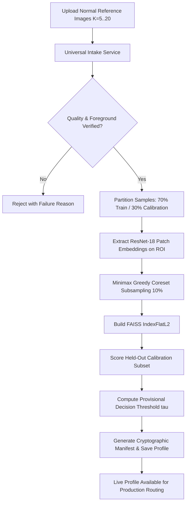

# DefectVision AI — Product Adaptation Guide

## 1. Overview

**Product Adaptation** enables DefectVision AI to inspect new manufactured components or adapt to new factory camera installations using **Few-Shot PatchCore Learning**. Rather than retraining a neural network from scratch, the system constructs a target-domain memory bank from a small set ($K = 5 \dots 20$) of defect-free normal specimens collected under station lighting.

### Core Principles
1. **Frozen Feature Extractor:** Reuses fixed mid-level feature representations from ResNet-18 (Layers 2 & 3, 384 dimensions) pretrained on ImageNet.
2. **Calibration Separation Principle:** Strictly separates training normal samples from calibration normal samples (default 70/30 split).
3. **Coreset Reduction:** Compresses patch representations via minimax greedy selection to 10% volume.
4. **Reproducible Artifacts:** Persists `profile.json`, `manifest.json`, `threshold.json`, `memory_bank.npy`, and `index.faiss` with cryptographic SHA-256 signatures.

---

## 2. Adaptation Workflow



---

## 3. Configuration Specification (`profile.json`)

```json
{
  "profile_id": "bottle_sku_btl_adapt_002",
  "product_id": "PROD-SKU_BTL_ADAPT_002",
  "product_name": "Clear Glass Bottle 500ml (Adapted Multi-Domain)",
  "sku": "SKU-BTL-ADAPT-002",
  "inspection_station": "Station Adapted — Clear Glass Bottle 500ml",
  "category": "bottle",
  "category_type": "object",
  "camera_id": "CAM-EXT-01",
  "lighting_profile": "ambient_or_diffuse",
  "acquisition_type": "controlled_photography",
  "validation_status": "PROVISIONAL ADAPTED REFERENCE PROFILE — FEW-SHOT ADAPTATION",
  "status": "active",
  "roi_config": {
    "type": "fixed_box",
    "relative_bbox": [0.0, 0.0, 1.0, 1.0],
    "fallback_to_contour": true
  },
  "quality_config": {
    "min_sharpness": 12.0,
    "min_brightness": 10.0,
    "max_brightness": 245.0,
    "min_contrast": 10.0,
    "max_overexposed_pct": 35.0
  },
  "threshold_config": {
    "calibrated_threshold": 1.6410,
    "target_far": 0.01,
    "calibration_sample_count": 2,
    "metrics": {
      "mean": 1.4917,
      "std": 0.0693,
      "p50": 1.4917,
      "p99": 1.5596,
      "max": 1.5610
    }
  }
}
```

---

## 4. Operational Best Practices

- **Sample Size:** For initial prototyping, $K=5$ normal images suffices. For certified line deployment, collect $K \ge 20$ normal images spanning daylight, night shift, and minor conveyor vibration.
- **Lighting Consistency:** Keep illumination steady. If lighting changes, create a separate profile or update references via `/api/production-profiles/{id}/update-references`.
- **Foreground Masking:** Ensure the target object occupies at least 15% of the frame. Textures automatically bypass bounding box cropping.
