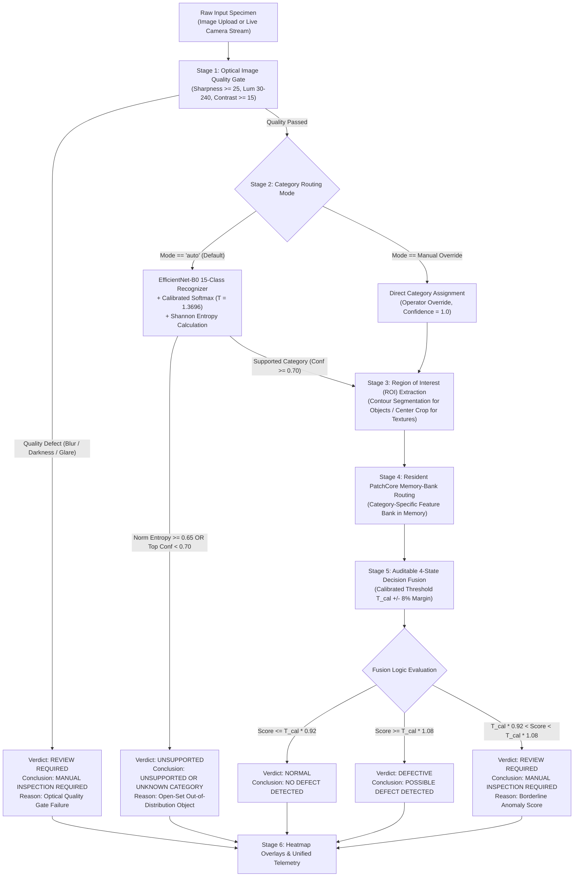

# DefectVision AI — Real-Time Automatic Category Recognition & Anomaly Inspection

## 1. System Overview

DefectVision AI delivers a production-grade, category-aware optical inspection system capable of inspecting products across all 15 official MVTec Anomaly Detection (AD) classes.

In conventional industrial anomaly detection systems, an operator is forced to manually select the product class from a menu or barcode scanner before inspection can commence. If the operator selects the wrong category, the anomaly detection model evaluates the image against an incorrect memory distribution, causing false alarms or catastrophic defect escapes.

DefectVision AI solves this bottleneck by implementing **zero-operator-intervention category routing**:
- Input images or live camera frames automatically pass through an integrated 15-class deep visual classifier.
- Once the category is identified, the specimen is dynamically routed to the corresponding resident PatchCore memory bank.
- Non-conforming, severely blurred, or unknown objects are safely intercepted before reaching anomaly scoring.
- Both **Image Upload** and **Live Camera** modalities operate under this unified, automated architecture by default, while retaining an optional manual category override when strict manual control is required.

---

## 2. Six-Stage End-to-End Pipeline Architecture

### Stage 1: Optical Image Quality Gate
Before feeding computational models, every frame is analyzed to ensure minimum optical fidelity:
- **Sharpness:** Laplacian variance $\sigma^2_L \ge 25.0$. Rejects motion-blurred or unfocused captures, calibrated specifically to allow transparent studio objects (such as glass bottles on seamless white backdrops) to pass without false rejection.
- **Luminance:** Mean pixel brightness $30.0 \le \mu_Y \le 240.0$. Rejects underexposed, dark frames or saturated overexposures.
- **RMS Contrast:** Standard deviation of gray levels $\sigma_Y \ge 15.0$. Intercepts washed-out or flat frames.
*Action upon failure:* Immediate exit with `verdict: "REVIEW REQUIRED"` and `conclusion: "MANUAL INSPECTION REQUIRED"`.

### Stage 2: Automatic Category Recognition & Open-Set OOD Rejection
- **Backbone:** ImageNet-pretrained EfficientNet-B0 fine-tuned with a lightweight linear classification head on nominal training samples across all 15 MVTec AD classes.
- **Calibrated Softmax:** Softmax outputs are calibrated using an empirically learned temperature $T = 1.3696$ to prevent uncalibrated overconfidence:
  $$p_i = \frac{\exp(z_i / T)}{\sum_j \exp(z_j / T)}$$
- **Shannon Entropy Uncertainty:** Normalized Shannon entropy is computed across the full class distribution:
  $$H_{norm}(P) = -\frac{1}{\ln K} \sum_{i=1}^{K} p_i \ln(p_i + \epsilon)$$
- **Open-Set Rejection Rule:** If top probability $p_{top} < 0.70$ or $H_{norm} \ge 0.65$, the input is flagged as out-of-distribution (OOD) and routed to `verdict: "UNSUPPORTED"` with `conclusion: "UNSUPPORTED OR UNKNOWN CATEGORY"`.

### Stage 3: Region of Interest (ROI) Extraction
Objects and textures exhibit fundamentally different spatial geometries:
- **Objects (10 classes):** `bottle`, `cable`, `capsule`, `hazelnut`, `metal_nut`, `pill`, `screw`, `toothbrush`, `transistor`, `zipper`. Evaluated using Otsu thresholding, morphological closing, and largest external contour bounding box extraction with padding.
- **Textures (5 classes):** `carpet`, `grid`, `leather`, `tile`, `wood`. Evaluated using a centered square region crop to avoid edge fixture artifacts.

### Stage 4: Resident PatchCore Memory-Bank Routing
- 15 category-specific coreset-subsampled memory banks are maintained resident in system RAM.
- Features are extracted from mid-level convolutional stages (e.g., layers 2 and 3) to capture both low-level texture details and higher-level structural semantics.
- Fast nearest-neighbor search computes the minimum distance to nominal patch representations.

### Stage 5: Auditable 4-State Decision Fusion
- Anomaly scores are benchmarked against category-specific decision thresholds ($T_{cal}$) calibrated on strictly disjoint validation splits.
- An auditable borderline guard band ($\pm 8\%$) prevents binary misclassification of specimens near the threshold:
  - **`NORMAL`:** $Score \le 0.92 \times T_{cal}$
  - **`DEFECTIVE`:** $Score \ge 1.08 \times T_{cal}$
  - **`REVIEW REQUIRED`:** $0.92 \times T_{cal} < Score < 1.08 \times T_{cal}$

### Stage 6: Heatmap Overlays & Unified Telemetry
- Pixel-level anomaly distance maps are bilinearly interpolated to the original specimen resolution, normalized, and converted to false-color JET heatmap overlays.
- A unified, typed JSON response schema is returned to both web applications and edge clients.
- All operator-facing diagnoses include the mandatory limitation disclaimer:
  > *"The result reflects the model's learned visual patterns and does not guarantee the absence of all possible defects."*

---

## 3. Four-State Operational Verdict Contract

| Verdict | Operator Conclusion | Badge Tone | Trigger Criteria | Action Required |
| :--- | :--- | :---: | :--- | :--- |
| **`NORMAL`** | `NO DEFECT DETECTED` | Emerald | Quality passed; Category recognized; Score $\le 0.92 \times T_{cal}$. | Component passes automated inspection. |
| **`DEFECTIVE`** | `POSSIBLE DEFECT DETECTED` | Rose | Quality passed; Category recognized; Score $\ge 1.08 \times T_{cal}$. | Reject or divert part to quarantine. |
| **`REVIEW REQUIRED`** | `MANUAL INSPECTION REQUIRED` | Amber | Quality gate failed OR Score within borderline band ($\pm 8\%$). | Secondary manual inspection by human QA specialist. |
| **`UNSUPPORTED`** | `UNSUPPORTED OR UNKNOWN CATEGORY` | Purple | Category recognizer entropy $\ge 0.65$ or confidence $< 70\%$. | Verify part placement or register new product profile. |

---

## 4. UI Modalities & User Workflows

### 1. Image Upload Inspection (`frontend/src/components/sections/InspectSection.jsx`)
- Default mode: **⭐ Auto Recognize Category (Default)**.
- The operator drops an image file onto the upload zone.
- The backend automatically executes the quality check, detects the category, extracts the ROI, scores the anomaly, and renders the result.
- An expandable category dropdown allows selecting an explicit category override if needed.
- Telemetry banners display the 4-state verdict, detected category, calibrated threshold, score comparison, and full operator diagnostic narrative.

### 2. Real-Time Live Camera Inspection (`frontend/src/pages/LiveStreamInspector.jsx`)
- Streams video frames from an attached industrial camera or browser webcam.
- An animated HUD targeting reticle guides object placement.
- When an object enters the frame, category recognition and PatchCore inference occur in real time.
- A live HUD verdict overlay displays the conclusion banner and anomaly telemetry.
- An inspection audit history buffer logs every processed frame with thumbnail snapshots, enabling one-click drill-down inspection.
