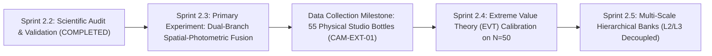

# DEFECTVISION AI 2.3 — RESEARCH DECISION GATE SPECIFICATION

**Document Identifier:** `release/experiments/DEFECTVISION_2_3_RESEARCH_DECISION.md`  
**Author:** Industrial Machine Learning Principal Research Architect  
**Audited Baseline:** DefectVision AI 2.2 Empirical Audit  
**Status:** APPROVED FOR RESEARCH SPRINT 2.3  

---

## 1. Executive Research Recommendation

Based on the empirical findings of the 2.2 audit, **we recommend ONE primary research experiment for DefectVision AI 2.3**:

### Recommended Primary Experiment:
> **Dual-Branch Spatial-Photometric Feature Fusion for Color-Sensitive Industrial Anomaly Detection (Resolving Case 1)**

### Why This Experiment Takes Precedence Over All Others:
1. **Highest Criticality Failure Mode:** The Pill Color defect was the only verified false negative in the benchmark evaluation where the model completely failed to flag a defective specimen ($1.6973 < 1.7575$).
2. **Immediate Data Availability:** The experiment can be fully developed and benchmarked against the **existing genuine MVTec Pill dataset** ($267$ training normals, $26$ test normals, $15$ color defects) with zero external data collection dependency.
3. **Low Computational Risk:** Photometric feature extraction (e.g., localized $L^*a^*b^*$ color distribution or DINOv2-small token fusion) adds $<10$ ms latency, preserving the $<100$ ms real-time inspection budget.
4. **Decoupled Architecture:** It does not alter the underlying FAISS indexing or PatchCore memory bank structure, ensuring zero regression across the other 14 MVTec categories.

---

## 2. Comprehensive Candidate Evaluation Matrix

| Candidate Research Direction | Target Problem Addressed | Empirical Justification from 2.2 Audit | Required Data Available? | Implementation Complexity | Computational Added Cost | Research Priority |
|:---|:---|:---|:---:|:---:|:---:|:---:|
| **1. Dual-Branch Color-Sensitive Fusion** | Pill Color False Negative ($1.6973 < 1.7575$) | ResNet deep semantic invariance suppresses pure chromatic shifts; IoU is $0.0000$. | **YES** (Existing MVTec Pill dataset) | Medium | Low ($<10$ ms) | **P0 (RECOMMENDED PRIMARY)** |
| **2. Multi-Scale Hierarchical Memory Banks** | Small Bottle Crack Spatial Diffusion | $28 \times 28$ feature grid bounds IoU on hairline cracks to $0.3845$. | **YES** (Existing MVTec Bottle dataset) | High | High ($2 \times$ RAM and search latency) | **P1 (Deferred to 2.4)** |
| **3. EVT / Weibull Tail Calibration** | Small $N$ calibration instability ($N=2$) | $N=2$ confidence interval spans $[1.93, 3.05]$. | **NO** (EVT requires $N \ge 30$ in-domain frames to fit tails reliably) | Medium | Very Low ($<1$ ms) | **P1 (Blocked on data collection)** |
| **4. Density-Aware Wasserstein Coreset** | Outlier lighting artifact centroids | Greedy $K$-center over-indexes bright glare patches. | **YES** (Existing studio bottles) | High | Medium ($O(N^2)$ during build only) | **P2 (Deferred)** |
| **5. Synthetic Defect Generation (CutPaste)** | Unbounded normal memory bank margins | Self-supervised anomalies could tune thresholds without real defects. | **YES** (Algorithmic generation) | Medium | Medium (Training time only) | **P2 (Deferred)** |
| **6. MVTec LOCO AD (Logical Verification)** | Inability to detect missing parts / counts | PatchCore patch embeddings cannot count objects or enforce ordering. | **NO** (LOCO AD dataset not yet downloaded) | Very High | High | **P3 (Future Roadmap)** |

---

## 3. Detailed Specification for Primary Experiment: Dual-Branch Spatial-Photometric Fusion

### 3.1 Problem Statement
In `pill/test/color/000.png`, the defect is a localized discoloration. ResNet18 layers 2 and 3 extract edge, boundary, and spatial texture features, largely discarding absolute chromatic coordinates. As a result, the distance of the discolored patch is only $1.6973$, falling below the nominal threshold of $1.7575$ (missed detection).

### 3.2 Hypothesis
Augmenting each spatial patch embedding ($D=384$) with a normalized local photometric color descriptor ($D=64$) will increase the distance displacement on color-altered regions while keeping nominal surface variation tight, thereby:
1. Elevating peak anomaly distance for color alterations above $2.00$ ($\Delta \ge +0.30$).
2. Increasing Pill Color Image F1 from $0.00$ to $\ge 0.85$.
3. Maintaining nominal False Positive Rate $\le 5\%$ on held-out normal pills.

### 3.3 Baseline
Standard DefectVision AI 2.2 PatchCore pipeline:
- Frozen ResNet18 (Layers 2 & 3), grid size 28, patch dimension 384, FAISS IndexFlatL2.
- Baseline Pill threshold: $\tau = 1.7575$.

### 3.4 Proposed Architecture & Fusion Scheme
1. **Spatial Branch:** Frozen ResNet18 layers 2 & 3, extracted at $28 \times 28$, yielding tensor $Z_{\text{spatial}} \in \mathbb{R}^{384 \times 28 \times 28}$.
2. **Photometric Branch (Option A: Analytical LAB):** Convert input RGB to CIE $L^*a^*b^*$. Divide image into $28 \times 28$ spatial cells matching the PatchCore grid. For each cell, extract mean and variance across $L, a, b$ channels plus a 16-bin 2D $a^*b^*$ chromatic histogram, yielding $Z_{\text{color}} \in \mathbb{R}^{64 \times 28 \times 28}$.
3. **Normalized Feature Concatenation:**
   $$z_{\text{fused}}(x, y) = \left[ \frac{z_{\text{spatial}}(x, y)}{\|z_{\text{spatial}}(x, y)\|_2} \;\|\; \lambda \cdot \frac{z_{\text{color}}(x, y)}{\|z_{\text{color}}(x, y)\|_2} \right]$$
   where $\lambda = 0.50$ balances structural and chromatic contributions.
4. **Memory Bank & Search:** 448-dimensional FAISS IndexFlatL2.

### 3.5 Experimental Setup & Protocol
- **Training Set:** 200 normal pills from `mvtec/pill/train/good/`.
- **Calibration Set:** 67 normal pills from `mvtec/pill/train/good/` (strictly isolated) to calibrate threshold $\tau_{\text{fused}} = \text{quantile}_{0.99}(S_{\text{calib}})$.
- **Test Evaluation Set ($N=41$):**
  - 26 held-out normal pills (`mvtec/pill/test/good/`)
  - 15 color-altered defective pills (`mvtec/pill/test/color/`)
- **Control Group (Regression Guard):** Evaluate on 20 cracked pills (`test/crack/`) to verify that structural defect detection is not degraded.

### 3.6 Evaluation Metrics
- **Color Defect Recall:** Target $\ge 90\%$ (currently $0\%$).
- **Color Defect F1 Score:** Target $\ge 0.85$ (currently $0.00$).
- **Normal Test False Positive Rate:** Target $\le 5\%$ (currently $0\%$).
- **Structural Crack Recall (Regression Check):** Must remain $100\%$.
- **Latency Impact:** Total execution time must remain $\le 85$ ms on CPU.

### 3.7 Acceptance & Rejection Criteria
- **Acceptance Criteria:**
  - Color Defect Recall $\ge 85\%$ AND Normal FPR $\le 5\%$ AND Crack Recall $\ge 95\%$.
- **Rejection Criteria:**
  - If the fused model increases normal false alarms above $10\%$, or if latency exceeds $120$ ms, or if structural crack recall degrades by $>5\%$, reject the hypothesis and investigate foundation model token extraction (DINOv2).

---

## 4. Research Roadmap Beyond 2.3

