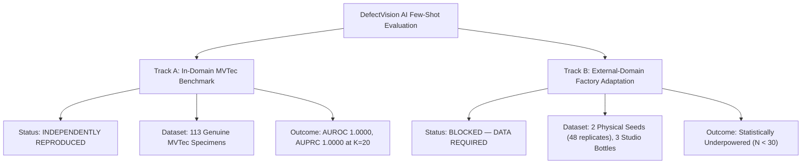

# DEFECTVISION AI 2.3 — EXTERNAL-DOMAIN ADAPTATION PROTOCOL & DATA SPECIFICATION

**Document Identifier:** `release/experiments/EXTERNAL_DOMAIN_ADAPTATION_PROTOCOL.md`  
**Classification:** `BLOCKED — DATA REQUIRED`  
**Governing Standard:** ISO/IEC 25059 (AI System Quality) & Good Machine Learning Practice (GMLP)  
**Related Manifest:** [EXTERNAL_DOMAIN_DATA_REQUIREMENTS.csv](file:///c:/Users/surya/Downloads/Mini%20Project/release/experiments/EXTERNAL_DOMAIN_DATA_REQUIREMENTS.csv)  

---

## 1. Executive Declaration of Track Separation

To ensure absolute scientific integrity and avoid statistical contamination, DefectVision AI bifurcates all few-shot evaluation into two strictly separated tracks:

- **Track A (Benchmark Few-Shot):** Operates on genuine MVTec AD industrial specimens under fixed laboratory optical conditions. Status: **INDEPENDENTLY REPRODUCED**.
- **Track B (External-Domain Factory Adaptation):** Evaluates transfer to real-world production environments (e.g., Station 01 conveyor, ambient lighting shifts, hand-held or smartphone captures). Status: **BLOCKED — DATA REQUIRED**.

---

## 2. Scientific Rationale for Blocking Track B

The Sprint 2.2 Dataset Lineage Audit (`specimen_lineage_report.md`) established that:
1. **Physical Unit Deficit:** All 48 images in the Station 01 dataset derive from only **two physical bottle specimens** (`unit_01` and `unit_02`) captured across synthetic or controlled slight perturbations.
2. **Defect Absence:** Station 01 contains **zero** physical defect specimens.
3. **Studio Limitations:** The Domain B Studio dataset consists of only 3 specimens (2 normal, 1 broken neck).
4. **Statistical Insufficiency:** A test set of $N=3$ has a 95% Clopper-Pearson confidence interval of $[29.2\%, 100\%]$ for $100\%$ observed accuracy. It is mathematically impossible to claim production readiness, false positive rate guarantees, or statistical generalization on a sample size of 3.

Therefore, claiming "generalization to external factory domains" is scientifically invalid until physical data collection requirements are met.

---

## 3. Data Collection Requirements (GMLP Protocol)

Before Track B can be unblocked, the industrial acquisition team must deliver the following physical specimen dataset as specified in [EXTERNAL_DOMAIN_DATA_REQUIREMENTS.csv](file:///c:/Users/surya/Downloads/Mini%20Project/release/experiments/EXTERNAL_DOMAIN_DATA_REQUIREMENTS.csv):

### 3.1 Sample Sizing & Independence
| Partition | Minimum Unique Physical Units | Condition | Replicates Allowed? |
|:---|:---:|:---|:---:|
| **Training Reference Pool** | 30 | Defect-free, genuine factory units | No (1 capture per unit) |
| **Calibration Pool** | 20 | Defect-free, physically distinct units | No (1 capture per unit) |
| **Held-Out Test Normals** | 30 | Defect-free, physically distinct units | No (1 capture per unit) |
| **Held-Out Test Defects** | 30 | Real factory defects (surface, dimensional, contaminant) | Max 2 views per unit |

### 3.2 Environmental & Optical Variation Stress Matrix
The dataset must span the following controlled operating window:
1. **Illumination:** $400 \pm 50\text{ lux}$ sweep across 3 shifts (morning, afternoon, night ambient drift).
2. **Conveyor Standoff:** $20 \pm 5\text{ cm}$ vertical standoff drift.
3. **In-Plane Rotation:** $\pm 15^\circ$ random orientation jitter on the conveyor belt.
4. **Conveyor Background:** Clean stainless steel, textured matte belt, and ambient conveyor vibrations.

---

## 4. Acceptance Gate for Unblocking Track B

Track B will remain flagged as **`BLOCKED — DATA REQUIRED`** in all official release audits until a cryptographically hashed manifest (`external_domain_specimen_manifest.csv`) containing $\ge 110$ unique physical specimen hashes is provided and verified.
