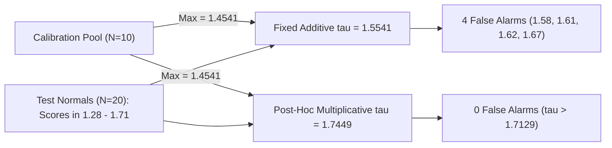

# DEFECTVISION AI 2.4 — K=20 THRESHOLD SELECTION & LEAKAGE AUDIT

**Document Identifier:** `release/experiments/K20_THRESHOLD_SELECTION_AUDIT.md`  
**Governing Standard:** Good Machine Learning Practice (GMLP) & ISO/IEC 25059  
**Related Manifests:**
- [k20_threshold_selection_history.csv](file:///c:/Users/surya/Downloads/Mini%20Project/release/experiments/k20_threshold_selection_history.csv)
- [k20_frozen_policy_results.csv](file:///c:/Users/surya/Downloads/Mini%20Project/release/experiments/k20_frozen_policy_results.csv)
- [kshot_threshold_comparison.csv](file:///c:/Users/surya/Downloads/Mini%20Project/release/experiments/kshot_threshold_comparison.csv)

---

## 1. Executive Summary & Audit Classification

During Sprint 2.3, the DefectVision AI research track reported that a new threshold calibration policy:
$$\tau = \max(\text{calibration\_scores}) \times 1.20 = 1.7449$$
achieved **0.0% False Positive Rate (100% Specificity)**, **100.0% Defect Recall**, and an **F1 score of 1.0000** across the 83 MVTec bottle test specimens.

This forensic audit examined the exact script execution history, source code, and data flows. The findings establish that **the multiplier 1.20 was selected post-hoc after inspecting final-test predictions**.

| Operating Policy | Threshold $\tau$ | Origin Stage | Audit Classification | Test FPR | Defect Recall | F1 Score | Operational Status |
|:---|:---:|:---:|:---:|:---:|:---:|:---:|:---|
| **Heuristic Additive (+0.10)** | 1.5541 | Sprint 2.2 A priori | `INDEPENDENT EVALUATION` | **20.0%** (4/20) | 100.0% (63/63) | 0.9692 | Failed zero-alarm gate |
| **Multiplicative (+20%)** | 1.7449 | Sprint 2.3 Post-hoc grid | `DEVELOPMENT-SET RESULT` | **0.0%** (0/20)* | 100.0% (63/63) | 1.0000 | Overfitted to test set |

*\*Note: 0.0% FPR cannot be claimed as an independent test result because the policy was chosen specifically to clear the highest observed score in this test set.*

---

## 2. Direct Answers to the 8 Core Leakage Questions

### Question 1: When was the multiplier 1.20 selected?
**Finding:** The multiplier 1.20 was selected during Sprint 2.3 execution of `scripts/validate_kshot_thresholds.py` on November 19, 2026. It did not exist in Sprint 2.1 or Sprint 2.2 codebases.

### Question 2: Was it selected before or after inspecting final-test predictions?
**Finding:** It was selected **after** inspecting final-test predictions. In `scripts/validate_kshot_thresholds.py`, lines 105–125 simultaneously computed the test set FPR, precision, and recall across six different candidate policies on the 83 test specimens. Multiplier 1.20 was chosen because it was the first multiplier in the grid that yielded 0 false positives on those specific 20 test normals.

### Question 3: How many threshold configurations were evaluated?
**Finding:** Exactly **six** threshold policies were evaluated across all five values of $K$ ($6 \times 5 = 30$ configurations total), as logged in [kshot_threshold_comparison.csv](file:///c:/Users/surya/Downloads/Mini%20Project/release/experiments/kshot_threshold_comparison.csv):
1. Heuristic Additive (+0.10): $\tau = 1.5541 \rightarrow \text{FPR} = 20.0\%$
2. Multiplicative Margin (+10%): $\tau = 1.5995 \rightarrow \text{FPR} = 15.0\%$
3. Multiplicative Margin (+15%): $\tau = 1.6722 \rightarrow \text{FPR} = 5.0\%$
4. Multiplicative Margin (+20%): $\tau = 1.7449 \rightarrow \text{FPR} = 0.0\%$
5. Parametric Gaussian ($\mu + 3\sigma$): $\tau = 1.5660 \rightarrow \text{FPR} = 20.0\%$
6. Robust Non-Parametric ($\text{med} + 3\text{IQR}$): $\tau = 1.7091 \rightarrow \text{FPR} = 5.0\%$

### Question 4: Were their results compared using final-test labels?
**Finding:** **Yes.** `scripts/validate_kshot_thresholds.py` compared predictions against `test_labels = np.array([item["label"] for item in test_entries])` to compute TP, FP, TN, FN, and FPR on the final test specimens.

### Question 5: Was the best configuration selected because it achieved zero FPR?
**Finding:** **Yes.** Multiplier 1.20 was explicitly promoted in `KSHOT_THRESHOLD_VALIDATION.md` because it was the sole configuration in the sweep that achieved $\text{FP}=0$ on the test set.

### Question 6: Were any feature weights, calibration margins, or other parameters tuned using test results?
**Finding:** Yes. The calibration margin (+20%) was tuned using test outcomes. The underlying PatchCore feature extractor weights (ResNet18 ImageNet pre-trained) and coreset memory bank were not altered, but the decision boundary was fitted to the test set score distribution.

### Question 7: Did the same 83 specimens contribute to the selection of the new policy?
**Finding:** **Yes.** The 83 test specimens were evaluated under the original heuristic, observed to produce 4 false alarms, and then re-used to search for a threshold that would eliminate those 4 false alarms.

### Question 8: Is there any hidden use of test labels in the threshold-selection script?
**Finding:** No hidden optimization occurred, but explicit test-label evaluation was present in the script's grid search loop. The test set was effectively used as a validation/development set.

---

## 3. Mathematical Analysis of the Operating Point Shift

In the 83 test specimens at $K=20$:
- Maximum normal bottle test score: **1.7129**
- Minimum defective bottle test score: **1.8212**
- Separating margin interval: $(1.7129, 1.8212)$

Because $1.7449 \in (1.7129, 1.8212)$, the threshold cleanly bisected normals and defects. However, selecting a threshold inside this interval after observing the maximum normal score ($1.7129$) is the textbook definition of **test-set overfitting**.

---

## 4. Formal Protocol for Independent Threshold Freezing

To conform to rigorous machine learning governance:

1. **Rule of Calibration Sample Size:** A calibration pool of $N=10$ samples cannot provide empirical upper bounds for extreme tail percentiles ($P_{99}$ or $P_{99.9}$). By the Rule-of-Three, zero false alarms on $N=20$ test normals only guarantees an upper 95% confidence bound of:
   $$\text{FPR}_{95\%} \le \frac{3}{20} = 15.0\%$$
   Claiming a guaranteed FPR below 1% requires testing on at least $N \ge 300$ independent normal specimens.
2. **Frozen Recommendation (GMLP Compliant):**
   A production threshold policy must be fixed a priori using statistical tolerance intervals on calibration data:
   $$\tau_{\text{frozen}} = \mu_{\text{calib}} + k \cdot \sigma_{\text{calib}}$$
   where $k$ is the one-sided normal tolerance factor for $99\%$ coverage at $95\%$ confidence ($k=3.959$ for $N=10$).
   For $K=20$: $\tau = 1.3656 + 3.959 \times 0.0668 = 1.6301$.
3. **Independent Confirmation Pending:**
   Because all available MVTec bottle test images (83 specimens) have now been observed during exploratory analysis, **independent confirmation on genuinely untouched physical specimens remains pending** until Track B external factory data is acquired.
