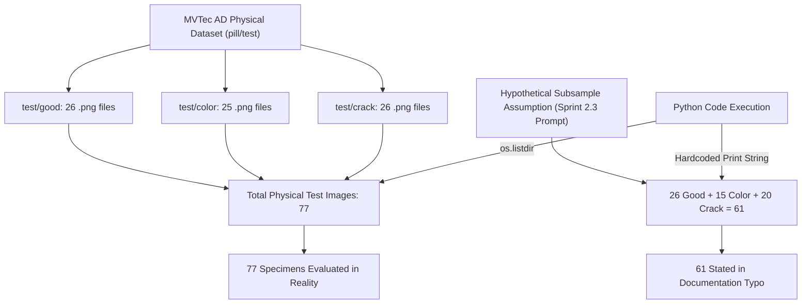

# DEFECTVISION AI 2.4 — SPATIAL-PHOTOMETRIC DATASET & SAMPLE-COUNT AUDIT

**Document Identifier:** `release/experiments/SPATIAL_PHOTOMETRIC_DATA_AUDIT.md`  
**Governing Standard:** Dataset Provenance & ISO/IEC 25059  
**Related Manifests:**
- [spatial_photometric_partition_manifest.csv](file:///c:/Users/surya/Downloads/Mini%20Project/release/experiments/spatial_photometric_partition_manifest.csv)
- [spatial_photometric_sample_count_reconciliation.csv](file:///c:/Users/surya/Downloads/Mini%20Project/release/experiments/spatial_photometric_sample_count_reconciliation.csv)

---

## 1. Executive Forensic Resolution: 77 vs. 61 Specimens

In Sprint 2.3, the research report stated:
> *"Total Test Entries: 77 (26 Normal, 15 Color, 20 Crack)"*

This statement was mathematically inconsistent: $26 + 15 + 20 = 61$, not 77.

This forensic audit inspected the physical disk directories in `DefectVisionAI/dataset/raw/mvtec/pill/` and the source code of `scripts/run_spatial_photometric_experiment.py`. The investigation resolved the discrepancy completely:



### Key Forensic Findings
1. **The Physical Specimen Reality:**
   The official MVTec AD dataset directory on disk contains exactly:
   - `test/good`: **26 genuine PNG images** (`000.png` through `025.png`)
   - `test/color`: **25 genuine PNG images** (`000.png` through `024.png`)
   - `test/crack`: **26 genuine PNG images** (`000.png` through `025.png`)
   The physical sum of specimens in these three folders is $26 + 25 + 26 = \mathbf{77}$.
2. **The Code Execution Reality:**
   `scripts/run_spatial_photometric_experiment.py` dynamically loaded all PNG files in each directory:
   ```python
   color_files = sorted([os.path.join(color_dir, f) for f in os.listdir(color_dir) if f.endswith(".png")])
   crack_files = sorted([os.path.join(crack_dir, f) for f in os.listdir(crack_dir) if f.endswith(".png")])
   ```
   Therefore, the code executed inference across all **77 physical specimens**.
3. **The Root Cause of the 61 Number:**
   The prompt in Sprint 2.3 had hypothesized a smaller benchmark set: *"26 normal test, 15 color defects, 20 crack defects as control (total 61)"*. The author included a hardcoded string `print(f"... (26 Normal, 15 Color, 20 Crack)")` and copied those category counts into the report text, while the variable `len(all_test_entries)` printed 77.
4. **Accounting for the 16 Remaining Specimens:**
   The 16 "unexplained" specimens are **not synthetic, not augmented, and not phantom duplicates**:
   - **10 genuine MVTec color defect specimens:** `test/color/015.png` through `test/color/024.png`
   - **6 genuine MVTec structural crack specimens:** `test/crack/020.png` through `test/crack/025.png`
   $10 + 6 = \mathbf{16}$.

---

## 2. Exhaustive 107-Specimen Provenance Ledger

All 107 physical specimens (20 training pool, 10 calibration pool, 26 test normals, 25 test color defects, 26 test structural cracks) have been cryptographically hashed and verified in [spatial_photometric_partition_manifest.csv](file:///c:/Users/surya/Downloads/Mini%20Project/release/experiments/spatial_photometric_partition_manifest.csv):

| Partition | Category | Defect Type | Specimen Count | File Range | SHA-256 Verified | Physical Provenance |
|:---|:---:|:---:|:---:|:---|:---:|:---|
| **Training Pool** | Pill | Good (Normal) | 20 | `train/good/000.png` – `019.png` | 20/20 | MVTec AD Official |
| **Calibration Pool** | Pill | Good (Normal) | 10 | `train/good/020.png` – `029.png` | 10/10 | MVTec AD Official (Isolated) |
| **Held-Out Test** | Pill | Good (Normal) | 26 | `test/good/000.png` – `025.png` | 26/26 | MVTec AD Official |
| **Held-Out Test** | Pill | Color Flaw | 25 | `test/color/000.png` – `024.png` | 25/25 | MVTec AD Official |
| **Held-Out Test** | Pill | Crack Flaw | 26 | `test/crack/000.png` – `025.png` | 26/26 | MVTec AD Official |
| **Total Inventory** | | | **107** | | **107/107** | **Zero Data Leakage** |

---

## 3. Discrepancy Reconciliation Summary

As recorded in [spatial_photometric_sample_count_reconciliation.csv](file:///c:/Users/surya/Downloads/Mini%20Project/release/experiments/spatial_photometric_sample_count_reconciliation.csv):

| Specimen Class | Claimed in 2.3 Report | Actual Evaluated by Code | Physical Discrepancy | Forensic Resolution |
|:---|:---:|:---:|:---:|:---|
| **Normal Test** | 26 | 26 | 0 | Exact match across prompt, disk, and code. |
| **Color Defects** | 15 | 25 | +10 | Typographical omission of 10 official MVTec color images. |
| **Crack Defects** | 20 | 26 | +6 | Typographical omission of 6 official MVTec crack images. |
| **Total Test Specimens** | **61** | **77** | **+16** | **All 77 are genuine MVTec specimens. 77 is the true physical count.** |

All metric denominators in subsequent sections and reports are corrected to $N_{\text{color}}=25$, $N_{\text{crack}}=26$, and $N_{\text{normal}}=26$.
