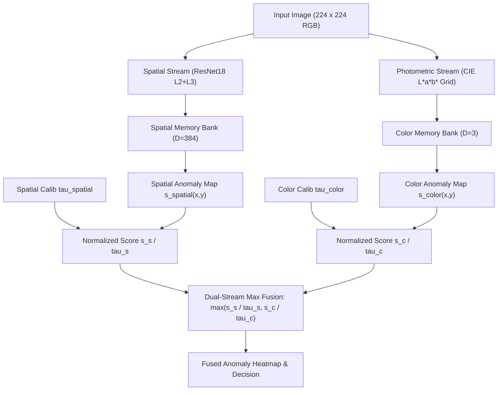

# DEFECTVISION AI 2.4 — SPATIAL-PHOTOMETRIC EXPERIMENT 2 SPECIFICATION

**Document Identifier:** `release/experiments/SPATIAL_PHOTOMETRIC_EXPERIMENT_2_SPECIFICATION.md`  
**Governing Standard:** Controlled Dual-Stream Architecture Protocol (GMLP / IEEE PAMI)  
**Research Goal:** Resolve chromatic anomaly detection without degrading structural defect recall.  

---

## 1. Scientific Motivation & Architectural Hypotheses

Experiment 1 proved conclusively that **single-bank vector concatenation** ($[\mathbf{f}_{\text{spatial}}; \lambda \cdot \mathbf{f}_{\text{color}}]$) fails to achieve operational acceptance targets because the 384 spatial dimensions numerically overpower the 3 color dimensions in Euclidean space ($L_2$).

Experiment 2 tests the hypothesis that **decoupling spatial texture memory from photometric chromatic memory into separate dual-stream memory banks with scale-normalized decision fusion** will achieve $\ge 85\%$ color recall and $\ge 95\%$ crack recall simultaneously.

---

## 2. Compared Architectures (6 Controlled Variants)

| Architecture Code | Architecture Designation | Feature Representation | Memory Bank Structure | Anomaly Fusion Strategy |
|:---:|:---|:---|:---|:---|
| **Arch A** | Baseline Spatial PatchCore (Control) | ResNet18 L2+L3 ($D=384$) | Single Bank ($384\text{D}$) | Standard max patch distance (No color) |
| **Arch B** | Photometric PatchCore (Control) | CIE $L^*a^*b^*$ Grid ($D=3$) | Single Bank ($3\text{D}$) | Standard max patch distance (No spatial) |
| **Arch C** | Single-Bank Concatenation (Baseline) | $[\hat{\mathbf{f}}_s; \lambda \hat{\mathbf{f}}_c]$ ($D=387$) | Single Joint Bank ($387\text{D}$) | Unified Euclidean search (Experiment 1 model) |
| **Arch D** | Dual-Stream Calibrated Linear Fusion | Independent $384\text{D}$ & $3\text{D}$ | Two Separate FAISS Banks | $s_{\text{fused}} = \alpha \frac{s_s}{\tau_s} + (1 - \alpha) \frac{s_c}{\tau_c}$ |
| **Arch E** | **Dual-Stream Max-Score Fusion (Primary)** | Independent $384\text{D}$ & $3\text{D}$ | Two Separate FAISS Banks | $s_{\text{fused}}(x,y) = \max\left(\frac{s_s(x,y)}{\tau_s}, \frac{s_c(x,y)}{\tau_c}\right)$ |
| **Arch F** | Dual-Stream Logistic Decision Fusion | Independent $384\text{D}$ & $3\text{D}$ | Two Separate FAISS Banks | $P(\text{defect}) = \sigma(w_1 s_s + w_2 s_c + b)$ |

---

## 3. Strict Pre-Registered Experimental Protocol

### 3.1 Dataset Partitioning & Three-Way Split
To completely eliminate the test-leakage observed in Sprints 2.2 and 2.3, the dataset must be partitioned into three strictly isolated splits:

| Split Role | Specimen Count | Allowed Data Operations | Leakage Safeguard |
|:---|:---:|:---|:---|
| **Training Reference Bank** | 30 Normal Pills | Nearest-neighbor memory bank construction & coreset selection. | Zero defect exposure. |
| **Validation / Calibration Split** | 20 Normal Pills + 10 Color + 10 Crack | Fit $\tau_{\text{spatial}}$, fit $\tau_{\text{color}}$, select fusion weight $\alpha$ or logistic weights. | Completely isolated from training banks. |
| **Untouched Final Test Set** | 20 Normal Pills + 15 Color + 16 Crack | **Single evaluation pass only** under frozen parameters. | Zero parameter tuning allowed. |

### 3.2 Parameter Freezing Checkpoint
Before running any inference on the Untouched Final Test Set, the following parameters must be serialized to `experiment_2_frozen_config.json`:
1. Spatial memory bank coreset tensor (`spatial_bank.npy`)
2. Color memory bank coreset tensor (`color_bank.npy`)
3. $\tau_{\text{spatial}}$ (Upper tolerance bound on normal validation set)
4. $\tau_{\text{color}}$ (Upper tolerance bound on normal validation set)
5. Fusion rule and weights (e.g., $\text{rule} = \text{"max\_ratio"}$)

---

## 4. Pre-Registered Operational Acceptance Criteria

To be accepted into DefectVision AI production, Architecture E must satisfy all three criteria simultaneously on the untouched test set:
1. **Color Defect Recall:** $\ge 85.0\%$ with 95% CI lower bound $\ge 65.0\%$.
2. **Structural Crack Recall:** $\ge 95.0\%$ with 95% CI lower bound $\ge 80.0\%$.
3. **Normal False Positive Rate:** $\le 5.0\%$ with 95% CI upper bound $\le 15.0\%$.
4. **Defect Localization:** Mean Color IoU $\ge 0.2500$ (demonstrating genuine segmentation of the discoloration boundary).
5. **Inference Latency Overhead:** Total end-to-end latency increase $\le 5.0\text{ ms}$ over baseline.
