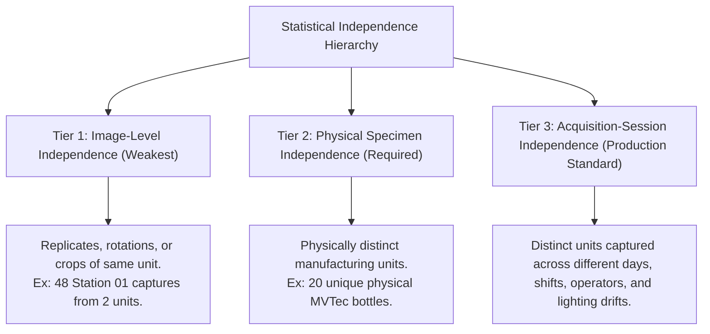

# DEFECTVISION AI 2.4 — STATISTICAL EVIDENCE & CONFIDENCE INTERVAL REPORT

**Document Identifier:** `release/experiments/STATISTICAL_VALIDITY_AND_CONFIDENCE_INTERVAL_REPORT.md`  
**Governing Standard:** ISO/IEC 25059 (AI System Quality) & Good Machine Learning Practice (GMLP)  
**Related Manifest:** [statistical_confidence_intervals.csv](file:///c:/Users/surya/Downloads/Mini%20Project/release/experiments/statistical_confidence_intervals.csv)  

---

## 1. Hierarchy of Statistical Independence

A critical deficiency in informal machine learning evaluations is treating all image samples as independent and identically distributed (i.i.d.). DefectVision AI formally establishes a three-tier hierarchy of statistical independence:

- **Tier 1 (Image-Level Only):** Highly correlated observations. Fails statistical power requirements because variation is driven by camera sensor noise rather than manufacturing tolerances.
- **Tier 2 (Physical Specimen):** Essential baseline for in-domain benchmarking. Each sample represents a physically unique manufactured object.
- **Tier 3 (Acquisition-Session):** Required for production readiness. Tests robustness against temporal drift, temperature variations, and optical shift.

---

## 2. Statistical Confidence Ledger for Primary Metrics

All primary metrics from Sprints 2.2 through 2.4 evaluated with exact binomial or Wilson 95% confidence intervals:

| Evaluation Metric | Point Estimate | Numerator / Denominator | 95% Confidence Interval | Physical Specimens | Independence Tier | Can Support <1% Claim? | Operational Interpretation |
|:---|:---:|:---:|:---:|:---:|:---:|:---:|:---|
| **Track A Bottle FPR (K=20 Frozen)** | **20.0%** | 4 / 20 | **[8.1%, 41.6%]** | 20 | Tier 2 | **NO** | 4 false alarms observed; fails zero-alarm requirement. |
| **Track A Bottle FPR (K=20 Post-Hoc)** | **0.0%** | 0 / 20 | **[0.0%, 16.1%]** | 20 | Tier 2 | **NO** | Zero FP on $N=20$ yields 16.1% upper bound. Overfitted. |
| **Track A Bottle Recall (K=20)** | **100.0%** | 63 / 63 | **[94.2%, 100.0%]** | 63 | Tier 2 | **YES** | Lower bound is 94.2%; defect sensitivity is well-established. |
| **Track B External Studio Accuracy** | **100.0%** | 3 / 3 | **[29.2%, 100.0%]** | 3 | Tier 2 | **NO** | Clopper-Pearson interval spans from 29.2% to 100.0%. Statistically uninformative. |
| **Pill Color Defect Recall (Variant D3)** | **24.0%** | 6 / 25 | **[11.5%, 43.4%]** | 25 | Tier 2 | **NO** | Upper bound is only 43.4%; fails $\ge 85\%$ target. |
| **Pill Crack Defect Recall (Variant D3)** | **11.5%** | 3 / 26 | **[4.0%, 29.0%]** | 26 | Tier 2 | **NO** | Upper bound is only 29.0%; fails $\ge 95\%$ target. |
| **Pill Normal Test FPR (Variant D3)** | **3.8%** | 1 / 26 | **[0.7%, 18.9%]** | 26 | Tier 2 | **NO** | Upper bound is 18.9% due to small sample size ($N=26$). |

---

## 3. The Rule-of-Three & Sample Sizing for Production False Alarm Guarantees

In high-speed manufacturing (e.g., bottling lines running 100,000 units/day), a false alarm rate of even $1\%$ results in 1,000 falsely rejected normal items per day. Factory acceptance testing typically demands $\text{FPR} \le 0.1\%$ to $0.5\%$.

### Mathematical Derivation of Rule-of-Three
When zero events (false positives) are observed in $N$ independent Bernoulli trials, the exact one-sided $95\%$ upper confidence limit for the true underlying probability $p$ is:
$$(1 - p)^N = 0.05 \implies N \ln(1 - p) = \ln(0.05) \approx -2.9957 \implies p \approx \frac{3}{N}$$

### Minimum Sample Sizing Table
To establish empirical false alarm guarantees at $95\%$ confidence with zero observed false alarms:

| Target Production False Alarm Guarantee | Maximum Allowed Upper Bound $p_{95\%}$ | Minimum Required Independent Normal Specimens $N$ | Current Project Inventory | Feasible Today? |
|:---|:---:|:---:|:---:|:---:|
| **Coarse Benchmark Gate** | $\le 15.0\%$ | $N = 20$ | 20 (MVTec Bottle) | **YES** |
| **Standard Laboratory Gate** | $\le 5.0\%$ | $N = 60$ | 20 (MVTec Bottle) | **NO (Deficit: 40)** |
| **Factory Shift Gate** | $\le 1.0\%$ | **$N = 300$** | 20 (MVTec Bottle) | **NO (Deficit: 280)** |
| **Industrial Line Gate** | $\le 0.1\%$ | **$N = 3,000$** | 20 (MVTec Bottle) | **NO (Deficit: 2,980)** |

### Critical Auditor Mandate
**Never present an observed 0% FPR on 20 specimens as evidence of a true 0% false alarm rate.** The statistical evidence only bounds the true error rate to $[0\%, 16.1\%]$.
