# DEFECTVISION AI 2.2 — SPECIMEN LINEAGE & PHYSICAL INDEPENDENCE REPORT

**Document Identifier:** `release/experiments/specimen_lineage_report.md`  
**Author:** Industrial Machine Learning Data Governance & Audit Team  
**Associated Artifacts:**
- Manifest: [`specimen_lineage_manifest.csv`](file:///c:/Users/surya/Downloads/Mini%20Project/release/experiments/specimen_lineage_manifest.csv)
- Visual Lineage Diagram: [`specimen_lineage_diagram.png`](file:///c:/Users/surya/Downloads/Mini%20Project/release/experiments/specimen_lineage_diagram.png)

---

## 1. Executive Summary: The "Unique SHA-256" Fallacy

In previous reporting, the observation that all 218 images possessed **unique SHA-256 cryptographic hashes** was cited as proof of "zero data leakage."

**The DefectVision AI 2.2 audit formally rejects this premise:**
- A cryptographic hash (SHA-256) proves only that bitstreams are non-identical.
- Applying an OpenCV affine rotation of $1^\circ$ or adding Gaussian noise with $\sigma=1.0$ creates a totally unique SHA-256 hash while retaining the exact same physical specimen, texture defects, and optical background.
- When an augmented derivative of an object is in the training set and another augmented derivative of that **same physical object** is in the test set, this constitutes **catastrophic physical data leakage**.

The lineage audit reveals that while the repository contains 91 unique image hashes across the core bottle evaluations, these derive from only **45 physical specimen roots**, of which 48 images are algorithmic variations of just **two physical objects**.

---

## 2. Visual Specimen Lineage Hierarchy

### Mermaid Lineage Flowchart

```mermaid
flowchart TD
    subgraph S1["PHYSICAL DOMAIN A: MVTec AD Benchmark"]
        M1["20 Physical Nominal Bottles"] --> A1["20 Unique Images (test/good)"]
        M2["20 Physical Defective Bottles"] --> A2["20 Unique Images (test/broken_large)"]
        A1 --> PT1["Partition: FINAL_TEST (Valid)"]
        A2 --> PT2["Partition: FINAL_TEST (Valid)"]
    end

    subgraph S2["PHYSICAL DOMAIN B: Controlled External Studio"]
        B1["Physical Studio Bottle A"] --> D1["clear bottle.jpg"]
        B2["Physical Studio Bottle B"] --> D2["clear bottle2.webp"]
        B3["Physical Broken Bottle"] --> D3["disordered bottle.webp"]
        D1 --> MB1["MEMORY_BANK_TRAIN (btl_adapt_002)"]
        D2 --> MB2["MEMORY_BANK_TRAIN (btl_adapt_002)"]
        D3 --> FT1["FINAL_TEST (Held-out)"]
    end

    subgraph S3["SYNTHETIC DOMAIN D: Station 01 Jitter Rig"]
        P1["Physical Seed: Nominal Bottle"] --> J1["OpenCV Jitter Engine (Affine, Scale, Lighting)"]
        P2["Physical Seed: Defective Bottle"] --> J2["OpenCV Jitter Engine (Affine, Scale, Lighting)"]
        J1 --> D4["25 Images (train_normal)"]
        J1 --> D5["15 Images (val_normal)"]
        J2 --> D6["8 Images (val_defect)"]
        D4 -.->|"Leakage if cross-tested"| D5
    end
```

---

## 3. Physical Provenance by Image Domain

### Domain A: MVTec AD Benchmark
- **Physical Specimens:** 40 physically distinct glass bottles (20 nominal, 20 broken).
- **Acquisition:** Standardized industrial laboratory rig with diffuse backlight.
- **Independence Status:** **100% Physically Independent.** Each image represents a distinct manufacturing specimen.
- **Partitioning:** Properly assigned to `FINAL_TEST`.

### Domain B: Controlled External Studio Photography
- **Physical Specimens:** Exactly 3 physical objects:
  1. `PHYS-EXT-STUDIO-BTL-A` (`clear bottle.jpg`)
  2. `PHYS-EXT-STUDIO-BTL-B` (`clear bottle2.webp`)
  3. `PHYS-EXT-STUDIO-BTL-BROKEN` (`disordered bottle.webp`)
- **Acquisition:** External DSLR studio photography under white ambient diffuser.
- **Independence Status:** The 3 objects are physically distinct from one another and from MVTec.
- **Leakage Finding:** Specimens A and B were placed in `MEMORY_BANK_TRAIN` for `bottle_sku_btl_adapt_002`. Consequently, evaluating normal bottle performance on Domain B evaluates **training-set memorization**, not out-of-sample physical generalization.

### Domain D: Factory-Style Stationary Jitter (Station 01)
- **Physical Specimens:** Exactly **two** physical seed objects:
  - 1 Nominal Bottle Seed (`RAW-MVTEC-BOTTLE-GOOD-000`)
  - 1 Defective Bottle Seed (`RAW-MVTEC-BOTTLE-BROKEN-LARGE-000`)
- **Algorithmic Derivatives (48 Total Images):**
  - `train_normal/`: 25 images generated via random rotations ($[-2^\circ, 2^\circ]$), translations ($[-5, 5]$ px), and brightness jitter ($[-8, 8]$).
  - `val_normal/`: 15 images generated with slightly wider jitter ($[-3^\circ, 3^\circ]$, $[-7, 7]$ px).
  - `val_defect/`: 8 images generated from the single broken seed.
- **Independence Status:** **0% Physically Independent.** All 40 nominal images in Station 01 are mathematical permutations of a single physical bottle.
- **Leakage Risk:** If an evaluation draws normal samples from `val_normal` while `train_normal` was used for memory bank training, the nearest neighbor query simply finds the closest affine transformation of the exact same physical glass surface.

---

## 4. Lineage Manifest Summary Table

Full records are persisted in [`specimen_lineage_manifest.csv`](file:///c:/Users/surya/Downloads/Mini%20Project/release/experiments/specimen_lineage_manifest.csv):

| Domain | Total Images | Unique Hashes | Physical Roots | Augmented / Synthetic | Partition Integrity Rule |
|:---|:---:|:---:|:---:|:---:|:---|
| **Domain A (MVTec)** | 40 | 40 | 40 | 0 (All Physical) | Valid partition isolation |
| **Domain B (Studio)** | 3 | 3 | 3 | 0 (All Physical) | Train/Test overlap on normals |
| **Domain D (Station 01)** | 48 | 48 | 2 | 48 (All Algorithmic) | Grouped split mandatory by seed ID |
| **TOTAL** | **91** | **91** | **45** | **48** | **Synthetic must be separated from Physical** |

---

## 5. Mandatory Grouped Splitting Protocol for Future Sprints

To ensure strict scientific validity, all future evaluations in DefectVision AI must enforce the following data governance rules:

1. **Grouped Splitting by Physical Specimen ID (`GroupKFold`):**
   No derivatives, transforms, crops, or multi-view captures of a physical specimen ID may exist in both the training/calibration set and the test set:
   $$\text{Specimens}(\mathcal{D}_{\text{train}} \cup \mathcal{D}_{\text{calib}}) \cap \text{Specimens}(\mathcal{D}_{\text{test}}) = \emptyset$$
2. **Explicit Labeling of Synthetic Robustness vs. Physical Generalization:**
   Reports evaluating affine jitter or synthetic noise must be explicitly titled **"Algorithmic Perturbation Robustness"**, never "Multi-Domain Physical Generalization".
3. **Audit Trail Verification:**
   Every dataset manifest record must contain `physical_specimen_id` and `source_image_id`. Unique SHA-256 hashes must be accompanied by the physical provenance root.
