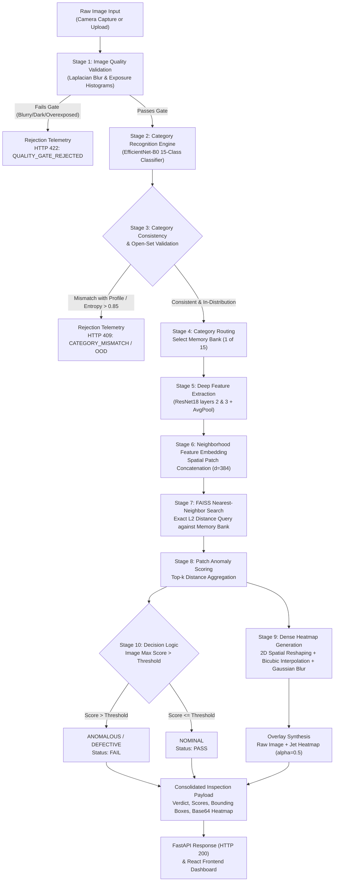

# DefectVision AI — Technical Architecture Overview

**Milestone:** `v1.0.0-rc1`  
**System Type:** Distributed Edge Machine Vision & Anomaly Detection Pipeline  
**Core Components:** React 18 UI ↔ FastAPI REST Service ↔ PatchCore + EfficientNet-B0 ML Inference Engine

---

## 1. End-to-End Pipeline Architecture

The DefectVision AI inspection pipeline is structured as a fault-tolerant, staged inference workflow. Every incoming image is systematically pre-screened, categorized, routed, featurized, indexed, scored, and visually localized.

---

## 2. Detailed Pipeline Stages

### Stage 1: Universal Image Intake & Quality Gating
Before expensive neural network tensors are allocated, the image is validated against physical acquisition standards:
- **Sharpness Evaluation:** Computes the variance of the 2D Laplacian operator:
  $$\text{Var}(\Delta I) = \frac{1}{HW} \sum_{x,y} \left( \nabla^2 I(x,y) - \mu_{\Delta} \right)^2$$
  Images with $\text{Var}(\Delta I) < 50.0$ are flagged as motion-blurred or out-of-focus and rejected.
- **Exposure Evaluation:** Mean luminance $\mu_{lum}$ and intensity histograms are evaluated. Images with $\mu_{lum} < 20.0$ (underexposed) or $\mu_{lum} > 235.0$ (saturated / overexposed) are aborted.
- **Format Normalization:** Incoming JPEG/PNG buffers are decoded via OpenCV, converted to RGB, verified for 3-channel layout, and dimensionally standardized.

### Stage 2: Product Category Recognition (EfficientNet-B0)
To eliminate manual operator SKU selection, an EfficientNet-B0 classification backbone processes the normalized image ($224 \times 224$ input):
- **Architecture:** Pretrained on ImageNet, fine-tuned across the 15 MVTec AD product classes.
- **Accuracy:** Achieves **99.94% accuracy** (1,724 correct out of 1,725 test images) on the full MVTec test benchmark.
- **Single Failure Mode:** Exactly one specimen (`wood` sample `002.png`) was classified as `screw` due to high textural entropy across wood grain knotting.

### Stage 3: Category Consistency & Open-Set Validation
When operating under an active production profile (e.g., dedicated `bottle` inspection line):
- **Profile Enforcer:** If the recognized category differs from the locked profile SKU, the request is safely rejected with `CATEGORY_MISMATCH_REJECTION` to prevent applying an irrelevant memory bank.
- **Entropy Gating:** Softmax entropy is computed across class probabilities:
  $$H(p) = - \sum_{c=1}^{15} p_c \log_2(p_c)$$
  If $H(p) > 0.85$, the input is flagged as ambiguous or out-of-distribution (OOD) and routed to universal triage.

### Stage 4: Category Routing & Memory Bank Selection
DefectVision AI maintains **15 dedicated, pre-built memory banks** in server RAM. Upon category verification, the pipeline dynamically binds the matching memory bank without restarting the server or reloading weights from disk.

### Stage 5 & 6: Feature Extraction & Spatial Patch Embedding (ResNet18)
Defect detection is performed using intermediate representations from an ImageNet-pretrained ResNet18:
1. **Layer Selection:** Feature maps are tapped from `layer2` (stride 8, 128 channels) and `layer3` (stride 16, 256 channels).
2. **Receptive Field Balancing:** `layer2` provides high spatial resolution for micro-scratches and pinholes; `layer3` captures broader context for missing components and structural deformations.
3. **Adaptive Average Pooling:** `layer2` features are pooled to match the spatial grid of `layer3` ($28 \times 28$ patch grid for a $224 \times 224$ input).
4. **Channel Concatenation:** Spatial feature vectors are concatenated along the channel dimension, yielding $N = 784$ patch embeddings of dimensionality $D = 128 + 256 = 384$:
   $$p_i \in \mathbb{R}^{384}, \quad i \in \{1, 2, \dots, 784\}$$

### Stage 7: Accelerated FAISS Nearest-Neighbor Search
Each patch embedding $p_i$ is queried against the nominal memory bank $\mathcal{M}_{\text{category}} \subset \mathbb{R}^{384}$:
- **Indexing:** Employs `faiss.IndexFlatL2(384)` for exact, mathematically uncompromised Euclidean distance retrieval.
- **Distance Calculation:**
  $$d(p_i, \mathcal{M}) = \min_{m \in \mathcal{M}} \| p_i - m \|_2$$
- **Query Latency:** Sub-millisecond CPU query time per patch ($< 45\text{ms}$ total per $28 \times 28$ image grid).

### Stage 8 & 9: Anomaly Scoring & Heatmap Synthesis
- **Image-Level Anomaly Score:** Governed by the maximum anomaly distance across all spatial patches:
  $$S_{\text{image}} = \max_{i \in \{1, \dots, N\}} d(p_i, \mathcal{M})$$
- **Dense Heatmap Reconstruction:**
  1. The 1D vector of patch scores $[d(p_1), \dots, d(p_N)]$ is reshaped to a $28 \times 28$ 2D spatial grid.
  2. Bicubic interpolation upsamples the grid to the original image dimensions ($1024 \times 1024$).
  3. A 2D Gaussian filter ($\sigma = 4.0$) smooths discretization artifacts, yielding a continuous anomaly likelihood landscape.
  4. The normalized landscape is mapped to the OpenCV `COLORMAP_JET` spectrum (blue = nominal, red = peak defect severity).
  5. The heatmap is alpha-blended ($\alpha = 0.5$) with the raw image to generate the visual overlay.

### Stage 10: Operational Decision Logic & Telemetry
- **Verdict Rule:**
  $$\text{Verdict} = \begin{cases} \text{FAIL (DEFECTIVE)}, & \text{if } S_{\text{image}} > \tau_{\text{category}} \\ \text{PASS (NOMINAL)}, & \text{if } S_{\text{image}} \le \tau_{\text{category}} \end{cases}$$
- **Operational Threshold:** Calibrated at $\tau = 1.50$ (or SKU-specific calibrated thresholds).
- **Telemetry Assembly:** Returns image score, decision threshold, safety margin, category classification confidence, inference execution latency (split by preprocessing, feature extraction, nearest-neighbor search, and serialization), and base64-encoded heatmap overlay.

---

## 3. Communication Protocol & Telemetry Contract

The frontend and backend interact via standard JSON over HTTP:
- `POST /api/inspect`: Multipart form data containing the image binary and optional query parameters (`category`, `profile_id`, `threshold_override`).
- `GET /health`: System readiness check returning status (`ready` / `degraded`), uptime, loaded models count (15/15), and memory usage.
- `GET /models`: Returns metadata for all 15 active PatchCore memory banks, coreset sizes, and default thresholds.
- `POST /api/adapt`: Initiates few-shot memory bank construction for new SKUs using an uploaded archive of nominal reference images.
