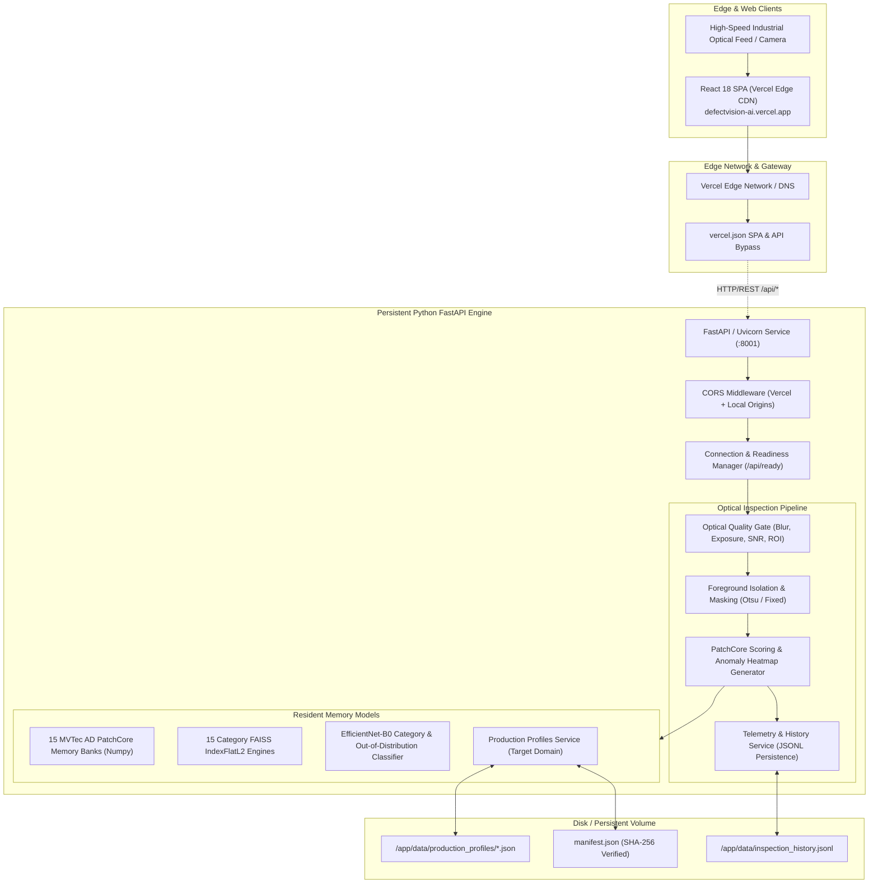
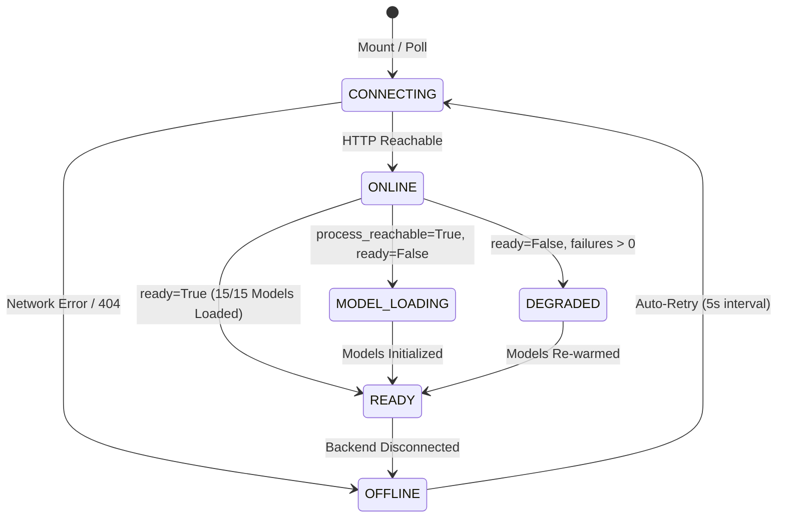

# DefectVision AI — Production System Architecture

**Document Version:** 3.0.0  
**Status:** Verified Full-Stack Production Specification  
**Target Release Candidate:** v1.0.0-prod / v1.0.0-rc1 baseline  
**Date:** November 2026  

---

## 1. Executive Summary

DefectVision AI is an industrial-grade computer vision platform engineered for zero-leakage, few-shot, and full-resolution visual anomaly detection and quality inspection across 15 distinct MVTec AD industrial categories and site-specific manufacturing production stations.

The platform is structured as a decoupled, multi-tier full-stack architecture:
1. **Frontend Presentation & Edge Telemetry Tier:** Single-page React application hosted on **Vercel** (`https://defectvision-ai.vercel.app/`), executing hardware-accelerated video canvas rendering, real-time ROI tracking, automated batching, and reactive connection state tracking.
2. **Persistent Machine Learning & Inference Service Tier:** A high-throughput **FastAPI** service running persistently on containerized or bare-metal infrastructure, retaining 15 category memory banks, FAISS `IndexFlatL2` similarity galleries, an EfficientNet-B0 visual classifier, and dynamic target-domain production profiles.
3. **Data & Storage Persistence Tier:** Disk-backed structured profile catalogs (`DEFECTVISION_DATA_DIR`), SHA-256 cryptographically verified manifests, and JSON Lines telemetry logs.



---

## 2. Decoupled Service Topologies

### 2.1 Why a Decoupled Architecture is Mandatory

| Requirement | Vercel Serverless Function Limits | DefectVision AI Persistent Backend | Architectural Rationale |
| :--- | :--- | :--- | :--- |
| **Execution Duration** | 10s (Hobby) / 60s (Pro) | Indefinite (Persistent Daemon) | Real-time multi-frame streaming and few-shot adaptation exceed serverless timeouts. |
| **Resident Memory** | 1024 MB - 3008 MB | ~1.5 GB - 3.2 GB Resident | Retaining 15 PyTorch models, 15 FAISS indices, and embedding models requires resident RAM. |
| **Cold Starts** | 15s to 35s per invocation | 0 ms (Models pre-warmed at boot) | Industrial inspection stations require deterministic latencies < 150 ms per frame. |
| **Model Persistence** | Read-only ephemeral filesystem | Writable persistent volume | Factory operators adapt new SKUs and calibrate thresholds live in production. |

### 2.2 Frontend Deployment Configuration (`vercel.json`)

To prevent Vercel's Single-Page Application (SPA) catch-all rewrite rule from intercepting API calls, the edge routing contract has been updated:

```json
{
  "rewrites": [
    {
      "source": "/((?!api/).*)",
      "destination": "/index.html"
    }
  ],
  "headers": [
    {
      "source": "/(.*)",
      "headers": [
        { "key": "X-Content-Type-Options", "value": "nosniff" },
        { "key": "X-Frame-Options", "value": "DENY" },
        { "key": "X-XSS-Protection", "value": "1; mode=block" },
        { "key": "Referrer-Policy", "value": "strict-origin-when-cross-origin" }
      ]
    }
  ]
}
```

---

## 3. Persistent Backend Topology & Endpoints

### 3.1 Service Lifecycle & Readiness Probe

The service provides dual health checking endpoints:
- `GET /api/ready` & `GET /ready`: Production readiness probe. Returns HTTP 200 when all 15 PatchCore models, calibrated decision thresholds, and FAISS indices are resident in RAM. Returns HTTP 503 if any model failed to load.
- `GET /api/health` & `GET /health`: Liveness probe indicating process reachability and subsystem status.

### 3.2 Production API Routes

| Endpoint | Method | Purpose | Response Format |
| :--- | :--- | :--- | :--- |
| `/api/ready` | `GET` | Readiness probe (15 models + FAISS) | JSON (HTTP 200 / 503) |
| `/api/health` | `GET` | Liveness & telemetry probe | JSON (System metadata) |
| `/api/predict` | `POST` | Primary MVTec/Production inference | JSON (Verdict, score, heatmap) |
| `/api/optical-inspection/inspect-frame` | `POST` | High-speed optical streaming frame | JSON (Verdict, ROI, telemetry) |
| `/api/optical-inspection/model-status` | `GET` | 15-category readiness matrix | JSON (Thresholds, tokens) |
| `/api/optical-inspection/history` | `GET` | Real-time session inspection history | JSON (Records, stats) |
| `/api/production-profiles` | `GET` | List target-domain station profiles | JSON (Profiles catalog) |
| `/api/production-profiles/{id}` | `GET` | Retrieve single profile manifest | JSON (Profile config) |
| `/api/production-profiles/adapt` | `POST` | Few-shot station adaptation | JSON (New profile manifest) |
| `/api/production-profiles/{id}/activate` | `POST` | Route traffic to profile | JSON (Status active) |
| `/api/production-profiles/{id}/evaluate` | `POST` | Evaluate profile validation split | JSON (Confusion matrix, ROC) |
| `/api/production-profiles/{id}/update-references` | `POST` | Update reference memory vectors | JSON (Updated profile) |
| `/api/models/comparison` | `GET` | Benchmark comparison matrix | JSON (Model accuracy metrics) |
| `/api/reports/summary` | `GET` | MVTec verification report summary | JSON (15-category AUROC) |

---

## 4. Frontend Dynamic Connection State Machine

The React frontend integrates a resilient connection manager (`frontend/src/api/client.js`) evaluating backend connectivity across 6 discrete states:



1. **`CONNECTING`:** Initial probe dispatched to `/api/ready`.
2. **`ONLINE`:** Process reachable, but model warmup in progress.
3. **`MODEL_LOADING`:** Backend actively deserializing memory banks into RAM.
4. **`READY`:** All 15 MVTec models and calibrated decision thresholds loaded; 100% operational.
5. **`DEGRADED`:** Subset of category models offline or storage unwriteable.
6. **`OFFLINE`:** Backend unreachable; frontend seamlessly activates mock fallback mode for visual UI demonstration.

---

## 5. Storage Persistence & File Isolation

To maintain compatibility with ephemeral containers (Docker, Kubernetes, AWS Fargate), all persistent data is externalized:
- **`DEFECTVISION_DATA_DIR`:** Root data directory (default: `DefectVisionAI/data`).
- **`DEFECTVISION_PROFILES_DIR`:** Production profiles directory (default: `DefectVisionAI/models/production_profiles`).
- **Manifest Cryptographic Integrity:** Every profile contains a `manifest.json` computing SHA-256 hashes for `memory_bank.npy` and `index.faiss`. Any unauthorized mutation or file corruption triggers an integrity error and halts inference routing.
